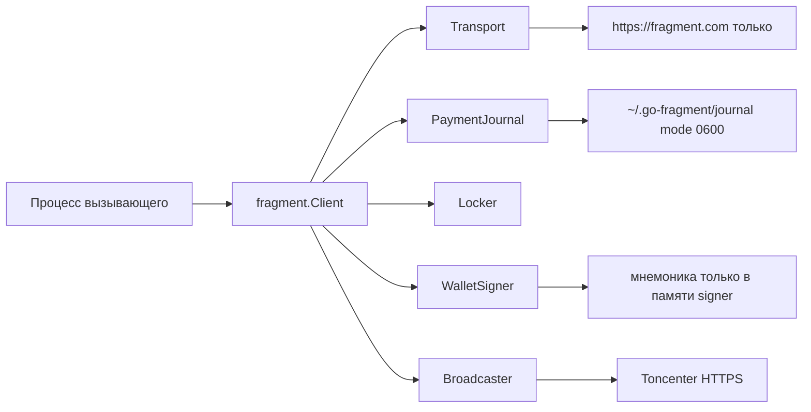
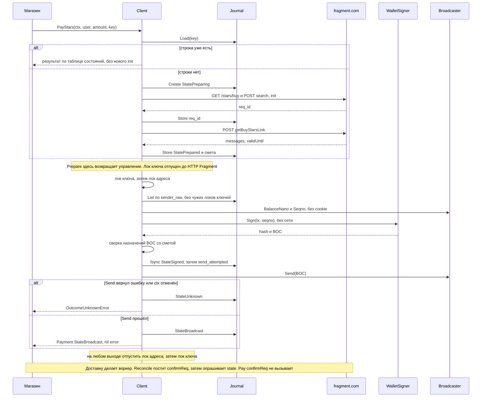
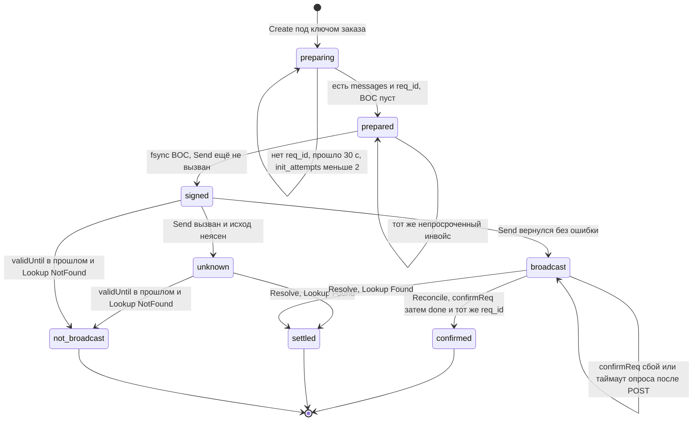

# go-fragment: локальный неофициальный клиент Fragment.com

| | |
|---|---|
| Автор | design draft |
| Дата | 2026-11-23 |
| Статус | Draft |
| Модуль | `github.com/andhash/go-fragment` |
| Язык реализации | Go 1.23+ |
| Характер | Неофициальный локальный плательщик. Не партнёрский API Fragment, Telegram или TON. |

Идентификаторы, имена типов и сигнатуры ниже записаны по-английски, как они появятся в коде. Репозитория go-fragment в рабочем дереве нет: документ проектирует библиотеку с нуля и не опирается на выдуманный локальный код.

## Overview

`go-fragment` — библиотека Fragment. Она разрешает Telegram-`@username` и покупает на этот аккаунт N Stars (минимум 50) либо дарит Premium на 3, 6 или 12 месяцев. Bot API Stars зачислить это не умеет. Касса — приватный сайт `fragment.com` (`/api?hash=...`). Официального партнёрского API Fragment не публикует. Библиотека — локальный плательщик в процессе вызывающего, а не размещённый HTTP-сервис и не прокси, которому отдают seed. Витрина, вебхук и доставка заказа, в том числе GGSEL, в модуль не входят: вызывающий сам передаёт username, сумму и свой ключ идемпотентности.

`go-fragment` даёт два равноправных режима. `Prepare` возвращает неподписанную транзакцию и разбираемую смету, ничего не отправляя в сеть TON. `Pay` подписывает и вызывает broadcaster только после того, как журнал с `fsync` записал подписанный BOC, и возвращает управление на `StateBroadcast`. Доставку Stars подтверждает отдельный `Reconcile`: он постит `confirmReq` сохранённым BOC и затем опрашивает state-метод. `Pay` `confirmReq` не вызывает. Это не вебхук и не интеграция витрины. Один и тот же ключ идемпотентности, который задаёт вызывающий, возвращает результат по таблице состояний ниже, а не новый инвойс. После появления `req_id` метод `init*` для этого ключа не вызывается больше никогда, даже если неподписанный инвойс протух: магазину нужен новый ключ. Неопределённый исход broadcast — типизированная ошибка, не успех, и автоматически не повторяется. `nil` error у `Pay` означает «broadcast принят либо строка уже `confirmed`/`settled`», но не «Fragment зачислил Stars», пока `State` не равен `confirmed` или `settled`.

Комиссия 1,5% и адрес `FEE_ADDRESS` из `fragment-api-py` в библиотеку не переносятся. Донат по умолчанию равен нулю; любой будущий донат — явная опция, виден в смете до подписи. Мнемоника не покидает локальный signer. Cookie сессии уходят только на `https://fragment.com`. Инцидент PyPI `fragment-api-py==14.4.2` (issue #8) считается угрозой первого класса: чужой код не должен получить ключ и не должен иметь возможности добавить исходящий перевод.

## Background & Motivation

### Зачем библиотеке идемпотентность

Покупатель Stars платит где-то снаружи. Библиотека этого платежа не видит. Вызывающий обязан идемпотентно, по своему ключу, исполнить одну покупку Fragment. Повтор вызова, таймаут HTTP и рестарт процесса — нормальные события, а не повод создать второй инвойс. Ошибка «непонятно, ушёл ли BOC» оставляет ключ в ручной сверке, а не в автоматическом retry. GGSEL — один возможный вызывающий и в этот модуль не импортируется.

Ожидаемая нагрузка одного продавца: порядка 1 покупки/с в среднем и короткие пачки до 5 параллельных заказов. Это не маркетплейсный поток. Журнал на локальной ФС и `flock` по адресу кошелька этому профилю соответствуют. Несколько хостов в v1 не поддерживаются хранилищем по умолчанию; интерфейсы журнала и блокировки это не запрещают.

Бюджет задержки: поиск получателя плюс инвойс — p95 короче 3 с, без подтверждения в цепочке. Подтверждение Fragment и включение сообщения в блок TON имеют отдельный таймаут (по умолчанию 60 с, опрос раз в 2 с) и в эти 3 с не входят.

### Что показывает fragment-api-py 14.4.1

Ориентир поведения, не образец для копирования: [S1qwy/fragment-api-py](https://github.com/S1qwy/fragment-api-py), 158 коммитов на `main`. Честный последний релиз — `v14.4.1`, тег от 2026-11-07, коммит `04a0601b6cc7f11af0291683ddd773b2d96eb689`. README рекомендует ставить именно этот pin. На PyPI пакет `14.4.1` тоже есть.

Это неофициальный async-SDK к приватному API сайта. Поверхность 14.4.1 шире v1 этой библиотеки: Stars, подарки Premium, розыгрыши каналов, пополнение Ads, кредиты Gateway, поиск по маркетплейсу (юзернеймы, номера `+888`, gifts), карточки активов и история, ставки и офферы, assignments, сессии, коды входа анонимных номеров, link/disconnect/logout кошелька, профиль с `identity_verified` и `wallet_verified`, вывод выручки `/stars/withdraw` и `/ads/withdraw` в три шага inspect/prepare/confirm. Вывод NFT — отдельные методы.

Полезные контракты, которые v1 сохраняет для Stars и Premium:

- Страницы и методы (`FragmentAPI/methods/purchases.py`, словарь `_FLOWS`), сверенные живой проверкой 2026-11-02: для Stars и Premium вернулись `req_id` и неподписанные TON-транзакции. Число выходов и адрес казны та проверка не сохранила. Санитизированного тела `getBuyStarsLink` в фикстурах нет: они синтетические. Выводы в той проверке не исполнялись.
- Stars: `https://fragment.com/stars/buy`, методы `searchStarsRecipient`, `updateStarsBuyState`, `initBuyStarsRequest`, `getBuyStarsLink`. Поиск передаёт `query` и пустой `quantity`. Init передаёт opaque `recipient`, `quantity`, `payment_method=ton`.
- Premium: `https://fragment.com/premium/gift`, методы `searchPremiumGiftRecipient`, `updatePremiumState`, `initGiftPremiumRequest`, `getGiftPremiumLink`. Месяцы — только 3, 6, 12.
- Hash страницы: regex `/api\?hash=([a-fA-F0-9]+)` после замены `\/` на `/`, кэш `HASH_TTL = 120` с, один принудительный refresh, если POST вернул ошибку `Bad request`. Иные POST не переигрываются: сервер мог уже применить вызов (`FragmentAPI/utils/http.py`).
- Тело link-запроса: JSON `account` (raw-адрес, `chain=-239`, `walletStateInit`, `publicKey`), `device` (отпечаток Tonkeeper из `DEVICE_INFO`), `transaction=1`, `id=<req_id>`, `show_sender` как `0` или `1`.
- Ответ link содержит `transaction.messages[]` с `address`, `amount`, `payload`, опционально `stateInit`, и `validUntil`. Суммы — целые nanotons. Принципал init-поля `amount` переводится в nanotons целочисленно, без `float64`. Если принципал неизвестен, подготовка отвергается, а не «оценивается».
- Подтверждение: `confirmReq` с тем же account, device и подписанным BOC, затем опрос state-метода. В v1 этот POST делает только `Reconcile`, не `Pay` и не `Broadcaster.Send`. Успех только при `mode=done`, `need_update=false` и id ответа, совпадающем с `req_id`. Чужое «done» страницы не считается исполнением. Интервал опроса 2 с, таймаут 60 с (`CONFIRMATION_INTERVAL`, `CONFIRMATION_TIMEOUT`).
- Состояния, которые видит вызывающий: Prepared, Broadcast, Confirmed, Unknown. Неопределённый broadcast не повторять новым платежом.
- Журнал до broadcast: подписанный BOC пишется раньше `send_message`. Запись не содержит мнемонику и cookie. Каталог по умолчанию `~/.fragment-api`, файл `0600`, каталог `0700`, `PRAGMA synchronous=FULL`. OS-lock кошелька — `flock` по SHA-256 канонического адреса; файл лока не удаляют. Несколько хостов требуют общее хранилище, локальный каталог его не заменяет.
- Cookie только пользовательские: `stel_ssid`, `stel_dt`, `stel_token`, для кошелька ещё `stel_ton_token`. Встроенный auth seed удалён в v14. Покупка без KYC всё равно требует свою сессию. Нет cookie — ошибка до любого запроса.
- Версии кошелька v14.4.1 включают V4R2, V5R1, HighloadV2, HighloadV3R1 и WalletTg. Для v1 достаточно V4R2 (до 4 сообщений) и V5R1. `mnemonic_type`: `ton` или `multichain`. Seed остаётся локальным.
- Аккаунт для инвойса собирается офлайн: raw-адрес, state init, публичный ключ. Мнемоника на этот шаг в HTTP не попадает.

Чего не переносим. В `FragmentAPI/types/constants.py` заданы `FEE_BASIS_POINTS = 150` и `FEE_ADDRESS = UQAcsdD09x9dzj7Jc-MznN-SLUxPPMmwKQxsC2Ax_F03TBAH`. `native_fee` в `FragmentAPI/utils/wallet.py` дописывает отдельное сообщение на этот адрес к нативному TON-платежу и округляет вверх. Это монетизация автора upstream, не комиссия Fragment и не комиссия сети. Для USDT и внешних EVM-инвойсов процент не применяется. `go-fragment` это сообщение не добавляет.

### Инцидент 14.4.2

9 ноября 2026 на PyPI появился неавторизованный `fragment-api-py==14.4.2`. Тега `v14.4.2` в GitHub нет. Issue [#8](https://github.com/S1qwy/fragment-api-py/issues/8): колесо собрано в основном из кода v13, версия подменена, в `wallet.py` добавлен `sweep_wallet_to_self`. Sweep вызывался при входе в async-контекст клиента и повторно из `execute_prepared` до отправки честного платежа. Он уводил весь USDT на TON и нативный баланс минус резерв на жёстко прошитый адрес. Автор репозитория подтвердил компрометацию PyPI-токена, удалил релиз и сверил перевод 43.982037696 TON в 2026-11-09 23:02:47 UTC. Хеши артефакта из issue:

- wheel `fragment_api_py-14.4.2-py3-none-any.whl`: `24c402f3c47e3d8bc29597d000def922fa507970e47322d6fd7f28a4d253d447`
- вредоносный `wallet.py` внутри wheel: `356850fb88116cb9a9d84ab5af5c21c6a3e3c06e41d4eafb1047dad68c718aa9`

Вывод для дизайна: публикация не равна исходному дереву; зависимость с правом подписи может опустошить кошелёк до бизнес-платежа; «официальный» пакетный индекс не является доверенной границей. Go-модуль этот класс ошибок сужает (нет install-script, есть checksum database), но не отменяет обзор диффа signer-зависимости и запрет чужих адресов в сообщениях.

### Почему не fragment-api-go

[S1qwy/fragment-api-go](https://github.com/S1qwy/fragment-api-go): вся история — 11 коммитов в один день, 2026-08-20. Коммитов с тех пор нет. 0 звёзд, 0 форков, тегов нет. README объявляет v1.0.0, batch, EVM, маркетплейс, NFT, QR-аутентификацию.

Фактический код уже́ уже:

- `PurchaseStars`, `PurchasePremium` и ads top-up ходят в `searchStarsRecipient` / `initBuyStarsRequest` / `getBuyStarsLink` и в аналоги Premium/Ads. Это единственная живая часть.
- `BatchPurchase` возвращает ошибку `"BatchPurchase not yet fully implemented"`, хотя README этот метод обещает.
- `DOC.md` описывает NFT transfer и вывод Stars. Файла `nft.go` нет. Тестов нет.
- `go.mod` лежит в подкаталоге `fragmentapi/` и объявляет модуль `github.com/s1qwy/fragmentapi` (Go 1.22, `github.com/xssnick/tonutils-go` v1.18.0). README пишет `go get github.com/s1qwy/fragment-api-go`. Инструкция установки не соответствует модулю.
- `Purchase` возвращает `(interface{}, error)`. Журнала до broadcast нет. Ключа идемпотентности нет. Cookie и seed лежат в `ClientConfig` обычными строками без контракта редактирования. Ошибки confirm проглатываются в том смысле, что вызывающий получает `PurchaseResult` без отдельного Unknown. Алиасы `gram` / `usdt_gram`, которые Python 14 удалил, ещё экспортированы.

Копировать это дерево значит унаследовать ложную поверхность и отсутствие гарантии «не платить дважды».

### Боль, которую закрывает новая библиотека

Магазину нужен маленький Go-модуль с корневым `go.mod`, проверяемыми фикстурами приватного API, журналом, сметой до подписи и ошибкой Unknown вместо «успешно отправлено». Ему не нужен маркетплейс, вывод средств и EVM-инвойсы в первой версии, но типы продукта и платежа нельзя забетонировать так, чтобы эти сценарии потребовали сломать сигнатуры.

## Goals & Non-Goals

### Goals (v1)

1. Модуль `github.com/andhash/go-fragment`, Go 1.23+, один `go.mod` в корне. Путь уже издательский. Публичный тег ставится после зелёных тестов плательщика, не раньше.
2. `context.Context` на каждом сетевом вызове. Функциональные опции. Узкие интерфейсы: `HTTPDoer`, `Transport`, `WalletSigner`, `Broadcaster`, `PaymentJournal`, `Locker`. Реализации по умолчанию входят в модуль. Тесты подменяют их фейками и прогоняют записанные фикстуры. Ни один тест не делает broadcast и не тратит средства.
3. Режимы `Prepare` и `Pay`. `Prepare` возвращает неподписанную транзакцию и `AmountBreakdown`. `Pay` подписывает и шлёт только после долговечной записи подписанного payload и возвращается на `StateBroadcast`. Подтверждение Fragment делает `Reconcile`: POST `confirmReq`, затем опрос state-метода. `Pay` этот POST не вызывает. Unknown — типизированная ошибка.
4. Обязательный ключ идемпотентности на каждую мутирующую покупку. Повтор `Pay` подчиняется таблице результатов, а не создаёт второй инвойс. После записанного `req_id` метод `init*` для этого ключа не вызывается. Протухший неподписанный инвойс не перевыпускается тем же ключом.
5. Мнемоника и cookie принимаются только опциями от вызывающего. Они редактируются в ошибках, логах и `fmt`. Мнемоника не уходит ни на один хост. Cookie — только на `fragment.com`. Запросы к Toncenter не содержат ни cookie, ни мнемонику. Подставленный `Broadcaster` тоже их не получает.
6. Нет телеметрии. Нет сбора телефонных номеров. Сессия v1 — только явная банка cookie вызывающего. TON Connect proof в v1 нет: на коммите `04a0601` `auth_ton_proof` проверяет `stel_ssid`, `stel_dt` и `stel_ton_token` и не получает `stel_token`. Без `stel_token` покупка невозможна, а Telegram OAuth этот дизайн не делает. QR-логин и proof отложены.
7. Реализованный объём v1: клиент, cookie-сессия, извлечение hash, поиск получателя, покупка Stars, подарок Premium, смета, prepare и pay, журнал, идемпотентность, типизированные ошибки, godoc, один рабочий пример Stars.
8. Имена методов и разбор HTML живут в одном пакете. Семантика версий — semver. Формат фикстур позволяет проиграть сохранённый ответ без сети.
9. Структурные логи с ключом идемпотентности и `req_id` Fragment, без секретов. Метрики prepare / pay / confirm / unknown. Имени витрины в полях нет.
10. Модель угроз закрывает: вредоносную зависимость (инцидент 14.4.2), retry в роли confused deputy, кражу cookie из логов, скимминг комиссии, смену HTML с подменой адреса, повтор подготовленной транзакции.

Лимиты протокола, которые v1 проверяет локально до сети:

| Параметр | Значение | Откуда |
|---|---|---|
| Stars | целое 50 … 10_000_000 | `STARS_PURCHASE_MIN` / `MAX` в 14.4.1 |
| Premium | 3, 6 или 12 месяцев | `PREMIUM_MONTHS_VALID` |
| Резерв газа по умолчанию | 50_000_000 nanotons (0,05 TON), отдельным сообщением не отправляется | `GAS_RESERVE_NANOTON` |
| Кэш hash | 120 с на страницу | `HASH_TTL` |
| Опрос подтверждения | каждые 2 с, не дольше 60 с | `CONFIRMATION_*` |
| Сообщений `PurposeFragment` | от 1 до `MaxFragmentMessages` (по умолчанию 4), даже для V5R1 | потолок лишнего выхода; V4R2 физически не вмещает больше 4. Ровно одно сообщение не требуется: число на 2026-11-02 этот документ не фиксирует |
| Донат поверх инвойса | не больше одного сообщения, его добавляет только сама библиотека | не приходит из `transaction.messages` |

### Non-goals v1

Следующее не реализуется и не экспортируется заглушками, которые притворяются рабочими (ошибка `fragment-api-go`). Имена продуктов и методов платежа остаются строковыми типами, чтобы продолжение не ломало сигнатуру `Order`.

| Тема | Почему не v1 | Куда ложится позже |
|---|---|---|
| Маркетплейс юзернеймов, номеров, gifts | не нужен доставке заказа | PR marketplace search |
| Ставки, офферы, отмена аукциона | мутации чужих активов | PR bids |
| Коллекционные gifts как покупка | другой flow | PR gifts |
| Номера `+888`, коды входа, terminate sessions | секреты логина; v1 их не печатает и не запрашивает | PR anonymous numbers |
| Розыгрыши Stars и Premium | другие методы и лимиты (`searchStarsGiveawayRecipient`, пакеты от 500, до 24_000 победителей Premium) | PR giveaways |
| Ads top-up и ads recharge | продукт `"ton"` в Python — это Ads, не перевод пользователю | PR ads |
| Gateway credits | отдельная страница `/gateway` | PR gateway |
| Выводы `/stars/withdraw`, `/ads/withdraw`, NFT withdraw | трёхшаговый необратимый flow, KYC, в проверке 2026-11-02 не исполнялся | PR withdrawals |
| Внешние инвойсы `usdt_tron`, `usdt_eth`, `usdt_pol`, `usdt_bsc`, `usdc_eth`, `usdc_base`, `usdc_pol` | SDK их не подписывает; магазин платит TON | PR EVM invoices |
| `usdt_ton` | локальная подпись jetton, отдельный баланс и мастер `EQCxE6mUtQJKFnGfaROTKOt1lZbDiiX1kCixRv7Nw2Id_sDs` | PR usdt_ton |
| WalletTg, HighloadV2, HighloadV3R1, `mnemonic_type=multichain` как рабочий путь | v1 подписывает только V4R2 и V5R1 схемой TON | PR wallets |
| QR / Telegram OAuth, ввод телефона | легко напечатать секрет; v1 запрещает phone scraping | PR qr login |
| TON Connect proof (`checkTonProofAuth`) | не выдаёт `stel_token` и сам по себе не покупает Stars; `stel_dt` библиотека не подставляет | PR ton proof |
| Пакетные покупки одним сообщением кошелька | схема 1 журнала — один инвойс на ключ; batch потребует схему 2 | PR batch |
| Redis, общий журнал на несколько хостов | лишняя зависимость и второй supply chain | PR shared journal |
| Prometheus-клиент в зависимостях модуля | метрики — интерфейс, без чужого экспортёра | адаптер у магазина |
| Размещённый API (fragment-api.net, qonix и аналоги) | они забирают seed или cookie и берут свои 2–3%; это противоположность локальному плательщику | не планируется |

Пакетная семантика на будущее, чтобы её не пришлось выворачивать: один combined external message, отказ до broadcast, если сообщений больше, чем позволяет кошелёк, никогда не резать пакет молча. Схема 1 журнала — один инвойс и один `req_id` на ключ. Batch не перечитывает старые файлы как пакет: он будет схемой 2 с массивом `confirmations`. v1 этот массив не пишет.

## Proposed Design

### Раскладка модуля

Один модуль, корень репозитория:

```text
go.mod                              // module github.com/andhash/go-fragment
go.sum
doc.go                              // пакет fragment
client.go                           // New, Client, опции
order.go                            // Order, Product, IdempotencyKey
prepare.go                          // Prepare, PrepareStars, PreparePremium
pay.go                              // Pay, PayStars, PayPremium, Balance
reconcile.go                        // Get, List, Reconcile, Resolve, Resume
breakdown.go                        // AmountBreakdown, целочисленный разбор сумм
errors.go
redact.go
metrics.go
account.go                          // Account, PreparedTransaction, Payment
record.go                           // Record, схема журнала 1
example/stars/main.go               // рабочий пример, не исполняется тестами
journal/file.go                     // журнал по умолчанию
lock/file.go                        // flock по умолчанию
wallet/local.go                     // WalletSigner V4R2 и V5R1
chain/toncenter.go                  // единственная включённая реализация Broadcaster
internal/protocol/flow.go           // имена страниц и методов
internal/protocol/hash.go           // единственный разбор HTML ради hash
internal/protocol/invoice.go        // разбор transaction.messages
internal/protocol/device.go         // отпечаток, который ждёт link
internal/transport/transport.go     // cookie scope, hash cache, POST
internal/fixture/fixture.go         // проигрывание testdata
testdata/fixtures/...
```

Пакет импорта — `fragment`. Публичные интерфейсы лежат в корне, чтобы магазин подставлял фейки без зависимости от `internal`. Реализации по умолчанию — отдельные пакеты с маленькой поверхностью. `internal/protocol` — единственное место, которое знает строки `searchStarsRecipient` и regex hash. Поломка вёрстки Fragment — правка этого пакета и фикстуры, не бизнес-слоя.

Зависимости v1, сознательно короткие:

| Модуль | Зачем | Чего не делает |
|---|---|---|
| `github.com/xssnick/tonutils-go` | адрес, state init, подпись V4R2/V5R1, сборка external message, разбор BOC | не выбирается как HTTP-клиент Fragment |
| `golang.org/x/sys` | `Flock` на Unix; Windows-реализация лока — в том же пакете `lock`, через `LockFileEx` | не сеть |

SQLite в v1 нет. Журнал — каталог JSON-файлов с атомарным rename. Так в доверенной вычислительной базе нет транспилированного SQLite и нет CGO. CGO выключен (`CGO_ENABLED=0` в CI).

В `go.mod` нет `replace` на чужой форк. Инструментальная цепочка фиксируется строкой `toolchain`. `go.sum` коммитится. Обновление `tonutils-go` — отдельный PR с просмотром диффа пакетов кошелька и прогоном `TestDenylistNotInModule`.

### Компоненты и граница секретов



| Компонент | Видит | Не видит и не отправляет |
|---|---|---|
| `Transport` | cookie Fragment, тела form POST | мнемонику, API-ключ цепочки, журнал |
| `WalletSigner.Sign` | мнемонику, уже разобранные сообщения | сеть; метод не имеет `*http.Request` |
| `Broadcaster` | подписанный BOC, опциональный API-ключ цепочки | cookie, мнемонику |
| `PaymentJournal` | ключ заказа, `req_id`, смету, подписанный BOC, состояние | cookie, мнемонику |
| Лог | `idempotency_key`, `req_id`, состояние, длительность, код ошибки, количество Stars или месяцев, nanotons сметы | cookie, `stel_dt`, мнемонику, payload, BOC, API-ключ цепочки, публичный ключ, ton-proof |

Нанотонны сметы пишутся в Info: это сумма, которую оператор сверяет до и после подписи, она не является секретом. Подписанный BOC в лог не попадает даже на Debug обработчика по умолчанию. Кто включит свой `slog.Handler`, получает записи уже после `RedactingHandler`.

### Поток Stars и Premium

Оба продукта идут через один незаэкспортированный `prepare(ctx, flow, order)` и один `pay(ctx, flow, order)`. Premium отличается константой `protocol.Premium` и проверкой месяцев. Это позволяет PR Premium быть тонким и не копировать журнал.

Имена, зафиксированные по коммиту `04a0601` и живой проверке 2026-11-02:

```go
package protocol

type Flow struct {
    Product      string
    Page         string
    SearchMethod string
    StateMethod  string
    InitMethod   string
    LinkMethod   string
    ConfirmMethod string // "confirmReq"
}

var Stars = Flow{
    Product:       "stars",
    Page:          "https://fragment.com/stars/buy",
    SearchMethod:  "searchStarsRecipient",
    StateMethod:   "updateStarsBuyState",
    InitMethod:    "initBuyStarsRequest",
    LinkMethod:    "getBuyStarsLink",
    ConfirmMethod: "confirmReq",
}

var Premium = Flow{
    Product:       "premium",
    Page:          "https://fragment.com/premium/gift",
    SearchMethod:  "searchPremiumGiftRecipient",
    StateMethod:   "updatePremiumState",
    InitMethod:    "initGiftPremiumRequest",
    LinkMethod:    "getGiftPremiumLink",
    ConfirmMethod: "confirmReq",
}
```

`Locker.Acquire` не реентерабелен. Повторный захват того же имени в том же процессе на `flock` блокируется навсегда. `Sign` и `Broadcaster` лок не берут. Клиент берёт каждое имя не больше одного раза за операцию. Единственный порядок: сначала лок ключа идемпотентности, потом лок raw-адреса. Обратный порядок запрещён. Пока держится лок адреса, лок ключа не берётся второй раз: он уже взят снаружи. На любом выходе из критической секции сначала отпускается лок адреса, затем лок ключа. Это касается и досрочных отказов: `ErrWalletBusy`, `ErrInvoiceExpired`, `ErrSpendLimit`, `ErrDestinationRejected`, `ErrBalanceUnavailable`, `ErrSeqnoUnavailable`, `ErrInsufficientBalance`, `ErrBreakdownMismatch`, `ErrJournal`. `ErrSeqnoUnavailable` отпускает оба лока до `Sign`.

Лок ключа держится на всём read-modify-write своей строки: `Load`, проверка `version`, временный файл, `rename`, `fsync` каталога. `Prepare` берёт его заново только вокруг `Create` и `Store` и отпускает до любого HTTP к Fragment. Во сне опроса `Reconcile` он не держится: каждая запись подтверждения или `Resolve` захватывает его заново и отпускает до следующей паузы. В критической секции `Pay` и `Resume` лок ключа взят раньше лока адреса и может оставаться на время Toncenter (`BalanceNano`, `Seqno`, `Lookup`, `Send`).

Критическая секция `Pay` начинается, только когда строка уже годный `prepared`: сообщения есть, заказ совпал, `validUntil` ненулевой и ещё не в прошлом. Строка с записанным `req_id`, у которой нет сообщений или `validUntil == nil`, в эту секцию не входит. Сначала лок ключа, затем лок адреса. Под обоими: `List` по `sender_raw` без захвата чужих ключей, баланс, `Seqno`, `Sign`, запись `StateSigned`, `fsync` `send_attempted`, `Send`, запись `broadcast` или `unknown`. `List` читает чужие строки как данные. `Acquire` по их ключам под локом адреса запрещён. Опрос Fragment в эту секцию не входит. `Resume` использует тот же порядок локов и ту же пару `release`.

Под обоими локами, до `Sign`, новый `Sign` для этого raw-адреса запрещён, если любая строка этого `List` находится в `signed`, `unknown` или в `broadcast` с `seqno_after == nil`. Результат — `ErrWalletBusy`, без `Sign` и без `Send`, затем отпуск адреса и ключа. Пачка из пяти заказов сериализуется по незакрытому seqno, а не на все 60 с подтверждения. `seqno_after` заполняет `Reconcile` без лока адреса. Если `Lookup == Found`, поле ставится сразу. Если `Lookup != Found`, вызывается `Broadcaster.Seqno`: поле ставится только когда текущий seqno строго больше `seqno_before`. Ошибка `Seqno` оставляет поле nil и не трактуется как `NotFound`. Пока поле пусто, соседний `Pay` получает `ErrWalletBusy`.

Шаги `Prepare` для Stars (Premium — те же, с полями `months` вместо `quantity`):

1. Локальная проверка: ключ идемпотентности, cookie `stel_ssid`, `stel_dt`, `stel_token`, для link ещё `stel_ton_token`, нормализованный username, количество, наличие `Account` (из signer или из `WithAccount`). Сеть не трогается, пока это не сошлось. Нет cookie — `ErrCookiesRequired`.
2. Взять только лок ключа заказа. Лок адреса не берётся.
3. Прочитать журнал под этим локом. Если строка есть, применить таблицу результатов `Pay` / `Prepare` из раздела API и перед возвратом отпустить лок ключа. `prepared` с сообщениями, тем же заказом и ненулевым `validUntil` в будущем возвращается как сохранённый инвойс: без `init`, без `updateStarsBuyState` с `mode=new` и без `get*Link`. Записанный `req_id` без сообщений или с `validUntil == nil` — только шаг 10, тоже без `init` и без `mode=new`. Истечение — только ненулевой `validUntil` в прошлом и пустой BOC: `ErrInvoiceExpired`, без `init`. Нулевое `time.Time` не читается как прошлое и не хранится. `validUntil == nil` — срок неизвестен, это не истечение.
4. Если строки нет, записать `StatePreparing` и `init_attempts = 1` (`Create`, `O_EXCL`). Проигравший гонки читает чужую строку и подчиняется таблице.
5. Отпустить лок ключа до любого HTTP к Fragment.
6. `GET` страницы продукта без редиректов. Вытащить hash. Кэш 120 с.
7. POST `updateStarsBuyState` с `mode=new`, `lv` из четырёх символов `false`, `dh` — десятичные наносекунды. Это сбрасывает черновик сессии Fragment. Денег ещё нет. Обрыв этого вызова не создаёт `req_id` и не является `StateUnknown`.
8. POST `searchStarsRecipient` с `query` и `quantity=""`. Пустой `found.recipient` — `ErrUserNotFound`. Телефон сюда не доходит: нормализатор отклоняет строку до запроса.
9. POST `initBuyStarsRequest` один раз за эту попытку, плюс не больше одного повтора того же POST, если тело ошибки в нижнем регистре равно `bad request` и кэш hash сброшен. Этот повтор не увеличивает `init_attempts` и не является 30-секундным осиротевшим `init`. Обрыв, таймаут и 5xx `init` не переигрывают. Пустой `req_id` в ответе — `ErrNoRequestID`, строка остаётся `preparing`, `req_id` пуст. Это не `StateUnknown`. Непустой `req_id` публикуется под заново взятым локом ключа: `O_EXCL` файла `journal/req/<sha256(req_id)>`, затем `fsync` строки, затем отпуск лока, и только потом `getBuyStarsLink`. Потеря ответа `init`, когда сервер уже создал id, оставляет `preparing` без `req_id`. Это принятое окно осиротевшего неоплаченного инвойса, не Unknown.
10. POST `getBuyStarsLink` с account, device, `transaction=1`, `id`, `show_sender`. Поле `evm` — `ErrUnexpectedPaymentFlow`. Этот шаг — первый link сразу после `init` в той же попытке и единственное восстановление позже: записанный `req_id` и при этом нет сообщений либо `validUntil == nil`. На этом пути нет `init*` и нет `updateStarsBuyState` с `mode=new`. Строка с `req_id` и `valid_until: null` идёт сюда и не возвращает `ErrInvoiceExpired`. Строка `prepared` с ненулевым `validUntil` в будущем сюда не входит: подписываются сохранённые сообщения, link заново не запрашивается. Две строки таблицы `Pay` не пересекаются.
11. Разобрать сообщения. Шкала сумм — в подразделе провода. Проверить адреса, `validUntil`, совпадение `transaction.from` с аккаунтом, принципал, число сообщений `PurposeFragment` в диапазоне 1…`MaxFragmentMessages`, отсутствие второго доната, денилист. Собрать `AmountBreakdown`. Pin казны на `Prepare` не требуется. Отсутствующий или нулевой `validUntil` в ответе link — ошибка разбора, нулевое время в журнал не пишется. Разобранный будущий срок пишется ненулевым `*time.Time`.
12. Заново взять лок ключа, записать `StatePrepared`, отпустить лок и вернуть `*PreparedPayment`. Подписи нет. Лок адреса по-прежнему не брался.

Повторный `init` без записанного `req_id` разрешён ровно один раз и только следующим вызовом `Prepare` или `Pay`: с момента `UpdatedAt` прошло не меньше 30 с и `init_attempts < 2`. Вызов увеличивает `init_attempts` до 2 и делает один новый `init`. Это не повтор внутри того же POST и не второй инвойс после известного `req_id`. Если `init_attempts` уже 2, результат — `ErrPrepareStuck`, сеть `init` не вызывается, магазину нужен новый ключ. Отдельного операторского «сбросить preparing и вызвать init» нет.

`Pay` входит в шаги 13–23 только для годного `prepared`: сообщения есть, `validUntil` ненулевой и в будущем. Если `req_id` уже есть, а сообщений нет или `validUntil == nil`, `Pay` выполняет только шаг 10 и не входит в критическую секцию. Подтверждение Fragment в шаги 13–23 не входит: `Pay` не вызывает `confirmReq`. Лок ключа к началу шага 13 отпущен: prepare-HTTP его не держал.

13. Взять лок ключа и перечитать строку. Если таблица `Pay` велит вернуться без подписи, отпустить только этот лок и вернуться. Лок адреса не брать. Сюда входят `ErrPrepareInProgress`, `ErrPrepareStuck`, `ErrIdempotencyConflict`, `NotSentError`, `OutcomeUnknownError` и уже записанные `broadcast`, `confirmed`, `settled`, `not_broadcast`. Если перечитанные сообщения пусты или `validUntil == nil`, это тоже выход до лока адреса: отпустить лок ключа и остаться на шаге 10. Только `get*Link`, без `init*` и без `updateStarsBuyState` с `mode=new`. Это не `ErrInvoiceExpired` и не разрешение подписать.
14. Взять лок адреса. Оба лока держатся до пары `release` в конце шага. Лок ключа под локом адреса не захватывается.
15. `List` по `sender_raw` без `Acquire` чужих ключей. Если у адреса есть `signed`, `unknown` или `broadcast` без `seqno_after` — `ErrWalletBusy`. Отпустить адрес, затем ключ.
16. Перечитать сообщения и `validUntil` под обоими локами. `validUntil == nil` или нет сообщений — не подписываемый инвойс. Это не истечение: `Sign` и `Send` не вызываются. Отпустить адрес, затем ключ. Строка остаётся на шаге 10: только `get*Link`, без `init*` и без `updateStarsBuyState` с `mode=new`. К pin и `Sign` переходить только если перечитанный указатель ненулевой, ещё в будущем и сообщения на месте. Ненулевой указатель в прошлом и пустой BOC — `ErrInvoiceExpired`, без `init`, без `Sign` и без `Send`. Отпустить адрес, затем ключ. Магазин создаёт новый ключ идемпотентности. Нулевое `time.Time` не читается как прошлое и не хранится.
17. Pin казны на сохранённых сообщениях `PurposeFragment`: адрес вне pin — `ErrDestinationRejected`, без подписи. `WithSpendLimit` обязателен и сравнивается с одним `RequiredNanoTON` (`sum(Messages) + GasReserveNanoTON`). Это один потолок в nanotons на операцию для всего клиента, не отдельный лимит на ключ идемпотентности. Магазин ставит его равным самому дорогому SKU. Донат второй раз не прибавляется. Превышение — `ErrSpendLimit`. Оба отказа: отпустить адрес, затем ключ, состояние остаётся `prepared`.
18. `BalanceNano` через Toncenter, без cookie. Сеть баланса недоступна — `ErrBalanceUnavailable`. Нехватка — `ErrInsufficientBalance`. Оба до подписи. Отпустить адрес, затем ключ.
19. `Broadcaster.Seqno` под уже взятым локом адреса. Ошибка чтения — `ErrSeqnoUnavailable`: до подписи, состояние остаётся `prepared`, `Sign` и `Send` не вызываются, оба лока отпускаются. Это не `ErrChainUnavailable` и не `OutcomeUnknownError`. Тот же ключ можно повторить, как при `ErrBalanceUnavailable`. Успешное значение передаётся в `Sign` аргументом. `Sign` не открывает сеть и не вызывает `Seqno` сам. Ошибка `Seqno` внутри `Reconcile` — другое правило: там поле `seqno_after` остаётся nil и чтение не считается `NotFound`.
20. Сверить назначения и суммы внутри возвращённого BOC с каноническим JSON сообщений, который ушёл в `Sign`. Лишний выход — `ErrBreakdownMismatch`, `Send` не вызывается, состояние остаётся `prepared`, подпись выбрасывается. Пустой hash или пустой BOC — та же развилка, до записи `signed`. Отпустить адрес, затем ключ.
21. Записать `StateSigned`, BOC, hash, `seqno_before`, `send_attempted = false`. `Store` делает `fsync`, пока лок ключа всё ещё держится с шага 13. Ошибка записи — `ErrJournal`, `Send` не вызывается, в журнале нет `signed`. Отпустить адрес, затем ключ. Следующий `Pay` может подписать заново, потому что долговечной подписи не было.
22. Поставить `send_attempted = true` отдельным `fsync` и только потом вызвать `Broadcaster.Send`. С этого вызова любая ошибка, обрыв, отмена контекста или неожиданный код — записать `StateUnknown` и вернуть `*OutcomeUnknownError`. Второго `Send` из `Pay` нет. Отпустить адрес, затем ключ.
23. Если `Send` вернулся без ошибки — записать `StateBroadcast`, отпустить адрес, затем ключ, и вернуть `(*Payment, nil)` со `StateBroadcast`. `Pay` не вызывает `confirmReq` и не опрашивает state-метод.

24. `Reconcile` — единственный вызов v1, который постит `confirmReq`. Это не `Broadcaster.Send` и не второй `init`. Тело: сохранённый `req_id`, сохранённый account JSON, те же байты `DEVICE_FINGERPRINT`, сохранённый BOC. Затем опрос state-метода. Успех — только `mode=done`, `need_update=false` и тот же `req_id`; тогда строка `confirmed`. Обрыв, таймаут или 5xx на `confirmReq` не повторяются внутри этого вызова: строка остаётся `broadcast`, результат `ErrConfirmUnavailable`. Это не `nil` и не `OutcomeUnknownError`. Заказ не помечается доставленным. Следующий `Reconcile` снова постит `confirmReq`. Если POST прошёл, а опрос за `ConfirmTimeout` (60 с) не увидел `done`, результат `(*Payment, *ConfirmationTimeoutError)` со `StateBroadcast`. Это тоже не `nil` и не повод для нового `Pay`. Воркер повторяет `Reconcile`, а не `Pay`.



Таймаут фазы до возврата `Prepared` (поиск плюс инвойс) по умолчанию 8 с на весь `Prepare`, чтобы здоровый Fragment укладывался в p95 3 с, а зависший сокет не ждал `DefaultTimeout` в 30 с из Python. Это цель, не обещание: четыре-пять RTT при RTT 100 мс занимают 0,5–1,5 с; p95 меньше 3 с достижим, когда Fragment отвечает. Если Fragment медленный, клиент возвращает `context.DeadlineExceeded` до подписи. `Pay` этим же бюджетом ограничен до возврата `broadcast` и не ждёт подтверждения. `ConfirmTimeout` 60 с принадлежит только `Reconcile`. Вызывающий не держит свой HTTP-запрос 90 с ради кассы: `Pay` возвращается на `broadcast`.

Матрица повторов POST, одна на весь клиент:

| Ситуация | Повтор |
|---|---|
| Тело с ошибкой, чей текст в нижнем регистре равен `bad request`, у любого метода, включая `init*` и `get*Link` | один сброс кэша hash и один повтор того же POST внутри этой попытки. `init_attempts` не растёт. Это не 30-секундный осиротевший `init` |
| `search*`, в журнале ещё нет `req_id`, HTTP 429 или обрыв до ответа | ещё не больше двух раз, пауза 200 мс |
| `init*`, `get*Link`, `confirmReq` при обрыве, таймауте или 5xx | не повторять внутри вызова |
| Новый вызов `Prepare`/`Pay` при `preparing` без `req_id`, возраст ≥ 30 с, `init_attempts < 2` | один новый `init`, это окно осиротевшего инвойса, не транспортный повтор и не hash-refresh |
| В строке уже есть `req_id` | `init*` не вызывать никогда. `get*Link` только если нет сообщений или `validUntil == nil`, и без `updateStarsBuyState` с `mode=new`. Ненулевой срок в будущем — подпись сохранённых сообщений, без нового link |

Редиректы выключены. Тело ответа ограничено 1 МиБ. Разрешённый URL для cookie: схема `https`, хост ровно `fragment.com`, порт пустой или 443, без userinfo. Любой другой URL в `page` — ошибка программирования flow, запрос не уходит.

### Провод Fragment

Поведение скопировано с коммита `04a0601`, а не придумано вторым протоколом. URL POST: `https://fragment.com/api?hash=<hex>`, hex — группа regex `/api\?hash=([a-fA-F0-9]+)`. Тело — `application/x-www-form-urlencoded`.

Заголовки, которые `build_headers` в `FragmentAPI/utils/http.py` ставит непустыми: `accept: application/json, text/javascript, */*; q=0.01`, `content-type: application/x-www-form-urlencoded; charset=UTF-8`, `origin: https://fragment.com`, `referer` и `x-aj-referer` равны URL страницы продукта, `x-requested-with: XMLHttpRequest`, `sec-fetch-dest: empty`, `sec-fetch-mode: cors`, `sec-fetch-site: same-origin`. Ключи со значением `None` (`sec-fetch-user`, `upgrade-insecure-requests`) не отправляются.

Поле `device` — не результат `encoding/json` от `map`. Это точная байтовая строка `DEVICE_FINGERPRINT` того коммита, `json.dumps(..., separators=(",", ":"))` от `DEVICE_INFO`:

```text
{"platform":"android","appName":"Tonkeeper","appVersion":"26.07.1","maxProtocolVersion":2,"features":["SendTransaction",{"name":"SignData","types":["text","binary","cell"]},{"name":"SendTransaction","maxMessages":255}]}
```

Поле `lv` во всех этих формах — четыре символа `false`, не `False`, не `0` и не JSON bool. Поле `dh` — десятичная запись целых наносекунд, как `time.time_ns()`.

| Вызов | Поля формы кроме `method` |
|---|---|
| `updateStarsBuyState` / `updatePremiumState` перед поиском | `mode=new`, `lv=false`, `dh` |
| `searchStarsRecipient` | `query`, `quantity` пустая строка |
| `searchPremiumGiftRecipient` | `query`, `months` |
| `initBuyStarsRequest` | `recipient`, `quantity`, `payment_method=ton` |
| `initGiftPremiumRequest` | `recipient`, `months`, `payment_method=ton` |
| `getBuyStarsLink` / `getGiftPremiumLink` | `account` (JSON), `device` (байты выше), `transaction=1`, `id`, `show_sender` `0` или `1` |
| `confirmReq` | `id` (сохранённый `req_id`), `account` (сохранённый JSON), `device` (те же байты `DEVICE_FINGERPRINT`), `boc` (сохранённый) |
| Опрос state-метода | `id`, `mode`, `lv=false`, `dh` |

Первый опрос подтверждения шлёт `mode=new`. Следующий копирует строку `response["mode"]`. Успех: `mode==done`, `need_update` именно JSON `false`, и `req_id` либо `id` ответа равны сохранённому `req_id`. Чужое `done` не считается.

`confirmReq` в v1 вызывает только `Reconcile`, и только после `StateBroadcast`. POST идёт на Fragment, не в `Broadcaster.Send`, и не создаёт новый `init`. Поля берутся из журнала: `req_id`, account JSON, байты `DEVICE_FINGERPRINT`, BOC. Опрос state-метода начинается после этого POST. Обрыв, таймаут или 5xx оставляют строку `broadcast` и возвращают `ErrConfirmUnavailable`: не `nil`, не `OutcomeUnknownError`, заказ не `confirmed`. Повтор — следующий вызов `Reconcile`, не второй POST внутри того же вызова. `Pay` этот метод не вызывает.

Шкалы сумм разные, как `decimal_units(..., 0)` для сообщения и `decimal_units(..., 9)` для init в `wallet.py` / `purchases.py` того коммита. Поле `amount` init переводится в nanotons умножением на 10^9. Поле `amount` у `transaction.messages[]` уже nanotons: масштаб 0, дробная точка, запятая и экспонента отвергаются. Фикстура `"amount":"500000000"` остаётся 500_000_000 nanotons, а не 5×10^17. Один парсер на обе шкалы запрещён.

Клиент по умолчанию — `net/http`. Сайт приватный и upstream ходит через `curl_cffi` с отпечатком Chrome. Этот документ не утверждает, что отпечаток Go TLS будет принят. Если Fragment отвергает рукопожатие, магазин передаёт `WithHTTPDoer` с нужным отпечатком. Подмена doer не снимает запрет редиректов и не расширяет хост cookie.

Редиректы выключены. Тело ответа ограничено 1 МиБ. Разрешённый URL для cookie: схема `https`, хост ровно `fragment.com`, порт пустой или 443, без userinfo. Любой другой URL в `page` — ошибка программирования flow, запрос не уходит.

### Состояния

Публичный словарь один. Внутренние синонимы Python (`sending` против `signed`) не дублируются.



Из `prepared` нет перехода обратно в `preparing`. Неподписанный инвойс с ненулевым `validUntil` в прошлом остаётся `prepared`, а `Pay` возвращает `ErrInvoiceExpired`. `validUntil == nil` этим переходом не закрывается: клиент повторяет `get*Link`.

`StateSigned` для вызывающего `Pay` не является успехом. Если процесс умер после `fsync` BOC и до `Send` (`send_attempted == false`), следующий `Pay` возвращает `*NotSentError` и не создаёт инвойс, не подписывает и не шлёт. Если `send_attempted` уже true, результат — `*OutcomeUnknownError`. `Get` в обоих случаях возвращает сохранённый `*Payment` и `nil` error: он не опрашивает сеть и не превращает состояние в ошибку.

`Reconcile` не вызывает `Broadcaster.Send` и не вызывает `init`. Он единственный в v1 постит `confirmReq`: сохранённый `req_id`, сохранённый account JSON, байты `DEVICE_FINGERPRINT` и сохранённый BOC. Это сообщение в цепочку TON не отправляет. После POST он опрашивает state-метод Fragment и `Lookup` по сохранённому hash. Лок адреса он не берёт. Лок ключа берёт только на запись и отпускает до сна и до HTTP. `Lookup == Unavailable` не доказывает отсутствие. `Lookup == Found` ставит `seqno_after`, если его ещё нет, и не означает доставку Stars. Если `Lookup != Found`, `Reconcile` вызывает `Broadcaster.Seqno`: при seqno строго больше `seqno_before` пишет `seqno_after` и снимает `ErrWalletBusy` с этого плательщика. Ошибка этого `Seqno` оставляет `seqno_after` nil и не считается `NotFound`; это не `ErrSeqnoUnavailable` шага 19. Обрыв, таймаут или 5xx на `confirmReq` оставляют `broadcast` и возвращают `ErrConfirmUnavailable`. Доставку Stars ставит только совпавший `req_id` после успешного `confirmReq` (`confirmed`). Сбой `confirmReq` доставку не ставит. Для уже `confirmed` или `settled` `Reconcile` возвращает ту же строку и `nil` и `confirmReq` не повторяет.

`Resolve(ctx, key, outcome, evidence)` принимает только `settled` или `not_broadcast`. `evidence` — непустая строка. Библиотека сохраняет её как есть и не разбирает. `confirmed` через `Resolve` переписать нельзя. Зачисление по тексту evidence не делается: совпавший `req_id` остаётся делом `Reconcile`. Для `settled` из `unknown` или `broadcast` в том же вызове обязателен `Lookup == Found`; иначе `ErrResolveRefused`, файл не меняется. Для `not_broadcast` в том же вызове обязаны выполниться оба условия: `validUntil` ненулевой и уже в прошлом, и `Lookup == NotFound`. `Lookup == Found` или `Unavailable` — `ErrResolveRefused`, состояние не меняется. Иначе можно вернуть покупателю деньги, пока подписанный BOC ещё может попасть в блок, либо пометить доставку, когда сообщения в цепочке нет. После успешного `not_broadcast` тот же ключ не платит заново. Новый платёж — новый id заказа.

`Resume(ctx, key)` — единственный v1-метод, которому разрешено вызвать `Send` для уже подписанного BOC. Он берёт лок ключа, затем лок адреса, и под локом ключа перечитывает `send_attempted`. Если поле уже true, `Send` не вызывается и результат — `OutcomeUnknownError`: этот вызов `nil` не возвращает. `Send` разрешён только когда одновременно `state == signed`, перечитанный `send_attempted == false`, `validUntil` ненулевой и в будущем, `Lookup == NotFound`. Тогда журнал сначала пишет `send_attempted = true` с `fsync`, и только потом вызывает `Send` того же BOC. `Lookup == Unavailable` не шлёт, не ставит `send_attempted` и не переводит строку в `unknown`: состояние остаётся `signed`, а результат — `ErrChainUnavailable`. Это не `OutcomeUnknownError`. Если `validUntil == nil`, срок не в будущем, или `Lookup == Found`, `Send` не вызывается, `send_attempted` не ставится, `nil` не возвращается. Результат — `ErrResumeRefused`. Это не `OutcomeUnknownError` и не `ErrChainUnavailable`. Если при этом `validUntil` ненулевой и уже в прошлом и `Lookup == NotFound`, godoc указывает на `Resolve(not_broadcast)` по уже заданному правилу. `Lookup == Found` и nil `validUntil` этот `Resolve` не открывают. На выходе лок адреса отпускается раньше лока ключа. `Pay` сам `Resume` не вызывает.

### Идемпотентность

```go
type IdempotencyKey string

func (k IdempotencyKey) Validate() error
```

Правила `Validate`: длина 1…128 байт, без пробелов и управляющих символов, только видимый ASCII. Ключ непрозрачен: библиотека не знает префиксов витрин и не принимает формат `ggsel:`. Пустой ключ — `ErrIdempotencyKeyRequired` до сети и до журнала.

Файл журнала называется SHA-256 ключа, не самим ключом: id заказа не должен становиться путём (`../`).

Совпадение ключа — это совпадение строки ключа, а не «тот же username». Если магазин передал тот же ключ с другим `Product`, нормализованным `Username`, количеством Stars или месяцев, `ShowSender`, raw-адресом плательщика или донатом, это `ErrIdempotencyConflict`. Сохранённый инвойс не пересобирается под новые опции. Pin казны в идентичность заказа не входит: он заново проверяется на `Pay` и при отказе даёт `ErrDestinationRejected`, без подписи.

Уникальность `req_id` не делается обходом каталога. Перед тем как строка с новым `req_id` станет видна, клиент создаёт `journal/req/<sha256(req_id)>` через `O_EXCL`. Содержимое файла — ключ идемпотентности. Чужой ключ в этом файле — `ErrReqIDConflict`, запись журнала не публикуется. Свой ключ означает повтор того же заказа. Оценка «десятки миллисекунд на 10 тысяч файлов» для горячего пути больше не используется. Свой `PaymentJournal` обязан дать ту же уникальность `req_id`, не обязательно файлом.

Параллельные `Pay` одного ключа сериализуются локом ключа. Второй ждёт, затем читает запись первого. `Create`, `Store`, запись подтверждения и `Resolve` держат этот лок на всём участке load, проверка версии, временный файл, `rename`, `fsync` каталога. `rename` без лока не является compare-and-swap: два писателя, прочитавшие одну `version`, иначе затрут друг друга последним `rename`. Несовпадение версии под локом — `ErrJournalConflict`, вызывающий перечитывает строку.

### Смета и комиссия

```go
type AmountBreakdown struct {
    Product               Product
    Quantity              int    // Stars либо месяцы
    PaymentNanoTON        int64  // принципал Fragment, не включая газ
    GasReserveNanoTON     int64  // не уходит отдельным сообщением
    DonationNanoTON       int64  // 0, если WithDonation не задан
    DonationAddress       string // пусто, если доната нет
    DonationBasisPoints   int    // 0 по умолчанию
    Messages              []MessageLine
    RequiredNanoTON       int64  // sum(Messages)+GasReserve
    ValidUntil            time.Time
}

type MessageLine struct {
    Purpose     MessagePurpose // fragment или donation
    Address     string         // raw workchain:hex
    AmountNano  int64
}
```

`PaymentNanoTON` берётся только из поля `amount` ответа init, масштаб 9. Парсер принимает десятичную строку или `json.Number`, переводит в nanotons умножением на 10^9 и отбрасывает ввод, у которого больше 9 знаков после запятой или есть экспонента. Суммы `transaction.messages[]` этим парсером не прогоняются. `float64` в этом пути запрещён тестом на исходнике (`go/ast` ищет `float32` и `float64` в `breakdown.go` и `internal/protocol/invoice.go`).

Принципал обязан быть меньше либо равен сумме сообщений `PurposeFragment`, без доната и без резерва газа. Иначе `ErrInvoiceMismatch`, подписи нет.

`RequiredNanoTON = sum(Messages) + GasReserveNanoTON` ровно один раз. `GasReserveNanoTON` отдельным выходом не является. Донат либо отсутствует, либо уже лежит одной строкой `PurposeDonation` внутри `Messages`. Лимит трат и проверка баланса читают только `RequiredNanoTON`. Пример целых чисел: принципал и одно сообщение Fragment по 500_000_000 nanotons, донат 150 б.п. даёт `(500_000_000 * 150 + 9999) / 10000 = 7_500_000`, сумма сообщений 507_500_000, резерв 50_000_000, `RequiredNanoTON = 557_500_000`. Не 565_000_000. Фикстура PR 3 проверяет это равенство.

Донат:

```go
type Donation struct {
    Address     string // вызывающий передал сам
    BasisPoints int    // 0…1000, то есть не больше 10%
    // либо фиксированная сумма, но не оба поля сразу
    FixedNanoTON int64
}

func WithDonation(d Donation) Option
```

Без опции `DonationNanoTON == 0` и в списке сообщений нет ничего, кроме сообщений Fragment. Формула процента, если опция задана: `(principal * basisPoints + 9999) / 10000`, те же целые, что upstream, но адрес только из опции. Строка доната видна в `AmountBreakdown` до `Sign`. `Pay` сравнивает сообщения, которые реально подписывает, с уже сохранённой сметой байт-в-байт. Расхождение — `ErrBreakdownMismatch`, send не вызывается.

Правило конструктора одно. Пустой адрес доната отвергается. Адрес sweep из issue #8 отвергается в любой форме, включая явный `WithDonation`. `FEE_ADDRESS` upstream принимается только как явный адрес `WithDonation` и больше нигде не появляется. По умолчанию доната нет, и этот адрес не подставляется.

Денилист объявлен дружественными строками и сравнивается только после разбора в raw `workchain:hex`. `UQ…` и `EQ…` одного аккаунта совпадают. Объявление:

| Аккаунт | Роль |
|---|---|
| `UQAolfC7fyf__0H-1GzG9y5ZtV2CPC7yDno4W2cSVuYlJ6DU` | sweep из wheel 14.4.2, issue #8. Запрещён всегда |
| `UQAcsdD09x9dzj7Jc-MznN-SLUxPPMmwKQxsC2Ax_F03TBAH` | `FEE_ADDRESS` в `FragmentAPI/types/constants.py` на `04a0601`. Запрещён, пока вызывающий сам не передал этот аккаунт в `WithDonation` |

`TestDenylistNotInModule` декодирует каждый строковый литерал модуля, похожий на адрес (`UQ…`, `EQ…`, `0:…` / `-1:…`), в raw и падает, если он равен любому аккаунту денилиста вне файла объявления денилиста. Падает и если объявление удалили. Сравнение сырых дружественных строк недостаточно.

Pin казны. `Pay` по умолчанию требует `WithFragmentTreasury`. Каждый адрес `PurposeFragment` должен попасть в этот набор после приведения к raw. Нет pin и нет `WithAllowUnpinnedTreasury()` — `ErrTreasuryUnpinned` до подписи. `Prepare` pin не требует: оператор один раз смотрит адреса в смете, сверяет их с кассой Fragment и кладёт в конфиг. Библиотека не зашивает адрес казны. `WithAllowUnpinnedTreasury` — только локальная отладка, пример Stars его не использует.

Число сообщений `PurposeFragment` — от 1 до `MaxFragmentMessages` (по умолчанию 4). Ровно одно не требуется: проверка 2026-11-02 не зафиксировала число выходов, upstream кладёт в смету каждое `transaction.messages[]`. Каждое такое сообщение на `Pay` обязано быть в pin. Сверх них библиотека добавляет не больше одного `PurposeDonation`. Сообщение доната из ответа Fragment не принимается: донат ставит только код библиотеки из опции. Больше потолка — `ErrTooManyMessages`.

### Секреты и редактирование

```go
type Cookies struct {
    SSID     string // stel_ssid
    DT       string // stel_dt
    Token    string // stel_token
    TONToken string // stel_ton_token
}

func WithCookies(c Cookies) Option
func WithMnemonic(mnemonic string) Option
func WithWallet(version WalletVersion) Option // V4R2 или V5R1
```

`Cookies`, обёртка мнемоники и `SignedMessage` реализуют `String`, `GoString` и `slog.LogValuer` так, что значения заменяются на `redacted` и длины. `Error()` у типов библиотеки прогоняется через `redact.Scrub`, который вырезает известные секреты клиента, если они случайно попали в текст Fragment. Журнал и логи этот scrub тоже проходят.

Мнемоника в v1 — схема TON, 24 слова, как обычный кошелёк V4R2/V5R1 в Tonkeeper. Неверная контрольная сумма отвергается локально, сеть не нужна. Двенадцать, пятнадцать, восемнадцать и двадцать одно слово в v1 не принимаются: у магазина один тип горячего кошелька, а лишние схемы — это WalletTg и multichain, отложенные следующим PR. Константа словаря BIP-39 в бинарник попадает только как часть проверки контрольной суммы внутри `tonutils-go`; свои слова библиотека не логирует.

Горячий кошелёк. Godoc и README требуют отдельный кошелёк, на котором лежит сумма только ближайших заказов плюс 0,05 TON резерва на каждый, и не лежит казна магазина. Библиотека это не может проверить технически. Она может ограничить один платёж через `WithSpendLimit`: один потолок в nanotons на операцию, равный самому дорогому SKU, не лимит на каждый ключ. Дневной потолок остаётся на стороне магазина: перед `Pay` магазин суммирует `RequiredNanoTON` по своим заказам. Баланс горячего кошелька магазин читает через `Client.Balance`.

`fmt` журнальной записи печатает hash сообщения и состояние, но не BOC. Метод `Record.SignedBOC()` есть, чтобы `Reconcile` и оператор могли достать payload, и помечен комментарием, что его нельзя писать в тикет и в чат.

### Транспорт, hash, фикстуры

`HTTPDoer`:

```go
type HTTPDoer interface {
    Do(ctx context.Context, req *http.Request) (*http.Response, error)
}
```

Контекст обязателен в сигнатуре, а не только внутри `req.Context()`. Реализация по умолчанию кладёт `ctx` в запрос и вызывает `http.Client` с `CheckRedirect`, который всегда возвращает `http.ErrUseLastResponse`. Отдельный `http.Client` у broadcaster, без `CookieJar`. Тест собирает клиент с мнемоникой-заглушкой и cookie-заглушкой, прогоняет фикстуру и проверяет, что запросы к хосту, отличному от `fragment.com`, не содержат заголовок `Cookie` и не содержат ни одного слова мнемоники.

`Transport`:

```go
type Call struct {
    Page   string
    Method string
    Fields url.Values
}

type Reply struct {
    HTTPStatus int
    Body       json.RawMessage
}

type Transport interface {
    Call(ctx context.Context, call Call) (Reply, error)
}
```

Реализация по умолчанию сама достаёт hash и подставляет `method`. Тесты подменяют весь `Transport`, не ходя в `internal`.

Фикстура — JSON schema 1 плюс файл HTML:

```json
{
  "schema": 1,
  "name": "stars_prepare_ok",
  "captured_from": "synthetic; method shape from commit 04a0601, not a captured getBuyStarsLink body",
  "pages": {
    "https://fragment.com/stars/buy": {
      "status": 200,
      "body_file": "stars_buy.html"
    }
  },
  "calls": [
    {
      "method": "searchStarsRecipient",
      "match": {"query": "durov"},
      "status": 200,
      "json": {
        "found": {
          "recipient": "recipient-token",
          "name": "Example User",
          "photo": "",
          "myself": false
        }
      }
    }
  ]
}
```

HTML содержит учебный hash `api?hash=0123456789abcdef`. Фикстуры синтетические: документ не утверждает, что санитизированное тело живого `getBuyStarsLink` или `getGiftPremiumLink` было снято. В фикстурах нет живых cookie, нет мнемоник, нет подписей ton-proof и нет зашитого адреса казны. В репозиторий нельзя класть сырой захват: вкладчик проходит санитайзер `internal/fixture.Sanitize`, который выкидывает заголовки `Cookie` и `Set-Cookie`, заменяет значения `stel_*` и обрезает файлы больше 1 МиБ. Команды «снять чужую сессию» в репозитории нет. Шагов извлечения cookie нет.

Тег сборки `fragmentlive` не вводится. CI вызывает `go test -race ./...` без сокета наружу. Это проверяется переменной окружения прокси `httptest` и отсутствием dial в тестах: broadcaster и transport в тестах — фейки. Случайный `http.Get` в тесте поймает review, а не «маленький» интеграционный прогон.

Контрактный тест `TestStarsPrepareFixture` поднимает последовательность: страница, state, search, init, link. Он проверяет, что клиент шлёт методы из `protocol.Stars` и что смена имени метода в тесте фикстуры падает в одном пакете.

### Подпись и broadcast

```go
type WalletSigner interface {
    Account(ctx context.Context) (Account, error)
    Sign(ctx context.Context, tx PreparedTransaction, seqno uint32) (SignedMessage, error)
}

type Account struct {
    Address         string // raw, workchain:hex
    Chain           string // "-239", mainnet
    WalletStateInit string // base64 BOC
    PublicKey       string // hex, не секрет того же уровня, но в лог по умолчанию не пишется
}

type SignedMessage struct {
    MsgHash string // hex нормализованного hash внешнего сообщения
    BOC     string // base64, редактируется в fmt
    Seqno   uint32
}

type Broadcaster interface {
    Send(ctx context.Context, msg SignedMessage) error
    Lookup(ctx context.Context, msgHash string) (LookupStatus, error)
    BalanceNano(ctx context.Context, rawAddress string) (int64, error)
    Seqno(ctx context.Context, rawAddress string) (uint32, error)
}

type LookupStatus string

const (
    LookupFound       LookupStatus = "found"
    LookupNotFound    LookupStatus = "not_found"
    LookupUnavailable LookupStatus = "unavailable"
)
```

`Sign` обязан быть чистой локальной операцией. Seqno приходит аргументом от `Pay` или `Resume`, которые уже вызвали `Broadcaster.Seqno` под локом адреса. `Sign` этот метод не вызывает и в сеть не ходит. Интерфейс не принимает `HTTPDoer`. Реализация `wallet.Local` не импортирует `net/http`. Это проверяется тестом импортов (`go/packages`). Возвращённый `SignedMessage.Seqno` равен переданному аргументу.

`chain.Toncenter` — единственная включённая в v1 реализация `Broadcaster`. Toncenter — это HTTPS API, которое читает seqno и баланс и рассылает уже подписанный BOC. Подпись остаётся локальной: `Sign` в сеть не ходит. Клиент ходит на URL из `WithChainEndpoint`, по умолчанию `https://toncenter.com/api/v2`. API-ключ, если он есть, оператор задаёт через `WithChainAPIKey`; он передаётся так, как требует Toncenter (заголовок `X-API-Key`), и никуда больше. Cookie jar у этого клиента `nil`. Таймаут одного RPC — 10 с. `Lookup` использует `lookupBlock` / поиск сообщения по hash средствами tonutils-go. Ошибка сети `Lookup` — это `LookupUnavailable`, не `NotFound`: «не смогли спросить» нельзя трактовать как «транзакции нет».

Клиента Tonconsole в v1 нет. Другую реализацию `Broadcaster` магазин подставляет через `WithBroadcaster`. У неё тот же контракт: ни cookie, ни мнемоники.

Отмена `ctx` до вызова `Send` — обычная ошибка, состояние остаётся `prepared` или, если BOC уже записан, переводится в `unknown` только когда `Send` уже был вызван. Правило для своих и чужих реализаций `Broadcaster`: метод `Send` есть точка невозврата; если реализация не может отличить «сервер не принял» от «сервер принял, ответ потерян», она возвращает ошибку, а клиент пишет Unknown. Оптимистично возвращать `nil` нельзя.

Повтор того же BOC идемпотентен на уровне hash внешнего сообщения TON. `Pay` его не шлёт. `Reconcile` постит сохранённый BOC только полем формы `confirmReq` на Fragment и не вызывает `Broadcaster.Send`. Единственный v1-вызов `Broadcaster.Send` для уже подписанного и ещё не отправленного BOC — явный `Resume`. Он берёт лок ключа, затем лок адреса, перечитывает `send_attempted` и только потом делает `fsync` `send_attempted = true` и `Send`. Условия `Send`: `state == signed`, перечитанный флаг всё ещё false, `validUntil` ненулевой и в будущем, `Lookup == NotFound`. Уже true флаг даёт `OutcomeUnknownError` без `Send`. `LookupUnavailable` оставляет строку `signed` с `send_attempted == false` и возвращает `ErrChainUnavailable`. `validUntil == nil`, срок не в будущем или `Lookup == Found` дают `ErrResumeRefused` без `Send` и без смены `send_attempted`. Просроченный неотправлённый BOC при `Lookup == NotFound` закрывается через `Resolve(not_broadcast)`, не через `nil` от `Resume`. Повтор вебхука до `Resume` не доходит: `Pay` его не вызывает.

### Аутентификация

В v1 один вход, без телефона, без QR и без TON Connect proof. Магазин передаёт свою браузерную банку через `WithCookies`: `stel_ssid`, `stel_dt`, `stel_token`, для оплаты ещё `stel_ton_token`. Библиотека не обновляет cookie, не выставляет `stel_dt` и не подставляет смещение `0` или `-180`. Какое значение `stel_dt` лежит в банке, решает оператор. Upstream перед `Wallet.init(` ставит `"-180"`; это его выбор для proof, не умолчание этой библиотеки.

`AuthenticateTONProof` в v1 не экспортируется и файла `internal/protocol/proof.go` нет. На коммите `04a0601` `auth_ton_proof` проверяет только `stel_ssid`, `stel_dt` и `stel_ton_token`. `stel_token` появляется из Telegram OAuth в `authenticate()`, который этот дизайн не делает. Proof поэтому не замена браузерной сессии и не покупает Stars. Будущий PR может добавить proof с godoc-строкой: функция не получает `stel_token` и сама по себе заказ не оплачивает. Смещение часового пояса в том PR передаёт вызывающий; библиотека не имеет права молча писать `stel_dt=0`. Если магазин выберет `-180`, это его настройка, не константа модуля. Тот PR не печатает cookie, `stel_token` и мнемонику. QR и телефон туда не входят.

Общий встроенный seed, `shared_auth_seed`, `nokyc_mode` не существуют. Покупка без своей сессии невозможна, как в Python 14.

### Нормализация получателя

Срезаются, в этом порядке, префиксы `https://t.me/`, `http://t.me/`, `https://telegram.me/`, `http://telegram.me/`, `t.me/`, `telegram.me/` и один ведущий `@`. Остаток, в котором ещё есть `/`, `?`, `#` или `&`, — `ErrInvalidUsername` до сети. Дальше строка должна совпасть с `^[A-Za-z][A-Za-z0-9_]{4,31}$`: 5…32 символа, первая буква. Это публичный минимум длины username Telegram. Четыре символа, которые допускало бы `{3,31}`, локально отвергаются. Upstream `recipient()` на `04a0601` длину не проверяет и `telegram.me` не режет; проверка длины — местное ужесточение, префиксы `t.me` совпадают с ним, `telegram.me` оставлен сознательно.

Строка, которая после удаления пробелов выглядит как телефон (`+` и цифры, либо только цифры длиннее 10), отклоняется как `ErrPhoneNotAccepted` до любого запроса. Библиотека не ищет человека по номеру и не шлёт номер на Fragment. Каналы и боты не отсекаются эвристикой по имени: Fragment сам вернёт ошибку, которую клиент завернёт в `ErrUserNotFound`, если в тексте есть признак «не пользователь», и в `ErrAlreadySubscribed`, если Premium уже активен (`already subscribed` в тексте ошибки, как `raise_api_error` в Python).

`Recipient`:

```go
type Recipient struct {
    Token    string // opaque found.recipient, не телефон и не user id Telegram
    Name     string
    PhotoURL string
    Myself   bool
}
```

`FindStarsRecipient` и `FindPremiumRecipient` экспортированы, чтобы магазин мог отказать в заказе до оплаты у себя, не создавая инвойс. Они не пишут журнал. Они всё равно требуют cookie и контекст.

### Ошибки

Корень — `Error` с методом `Code() string`. Сравнение через `errors.Is` / `errors.As`.

| Код | Когда | Можно ли повторить Pay тем же ключом |
|---|---|---|
| `cookies_required` | нет обязательных имён cookie | да, после того как вызывающий передал cookie; журнал не создан |
| `idempotency_required` | пустой ключ | да, с ключом |
| `idempotency_conflict` | тот же ключ, другие поля заказа | нет |
| `invalid_stars_amount` | вне 50…10_000_000 | нет, пока заказ не исправлен новым ключом, если строка уже создана; до журнала — да |
| `invalid_months` | не 3, 6, 12 | то же |
| `user_not_found` | пустой recipient или текст Fragment | да, пока нет `req_id`; магазин обычно не должен повторять без смены username |
| `already_subscribed` | Premium уже есть | нет смысла платить |
| `hash_not_found` | на странице нет hash | да, до `req_id` |
| `no_request_id` | init без id; строка остаётся `preparing`, это не `StateUnknown` | да, следующим вызовом, если с `UpdatedAt` прошло ≥ 30 с и `init_attempts < 2` |
| `prepare_in_progress` | `preparing`, нет `req_id`, возраст меньше 30 с | нет, подождать тот же ключ |
| `prepare_stuck` | `preparing`, нет `req_id`, `init_attempts` уже 2 | нет; новый ключ. `init` не вызывается |
| `treasury_unpinned` | на Pay нет pin | да, это локальный отказ до подписи |
| `destination_rejected` | адрес вне pin или в денилисте | нет, пока оператор не сменит pin отдельным процессом; инвойс остаётся prepared |
| `spend_limit` | смета выше лимита | да, до подписи, тем же prepared |
| `insufficient_balance` | баланс ниже сметы | да, до подписи, после пополнения горячего кошелька |
| `balance_unavailable` | Toncenter не ответил балансом до подписи | да, тем же ключом; состояние остаётся `prepared` |
| `seqno_unavailable` | `Pay`: `Broadcaster.Seqno` не ответил до `Sign` | да, тем же ключом; состояние остаётся `prepared`. `Sign` и `Send` не вызываются. Это не `chain_unavailable` и не `outcome_unknown` |
| `invoice_expired` | `req_id` записан, BOC пуст, `validUntil != nil` и в прошлом | нет; новый ключ. `validUntil == nil` — не этот код, а повтор `get*Link`. Клиент `init` не вызывает |
| `not_sent` | `signed` и `send_attempted == false` | нет из `Pay`. `Resume` — отдельный вызов, `Pay` его не делает |
| `chain_unavailable` | `Resume` увидел `LookupUnavailable` до `Send` | да, тем же `Resume`. Строка остаётся `signed`, `send_attempted` остаётся false. Это не `outcome_unknown` и не отказ seqno до подписи |
| `resume_refused` | `Resume` не шлёт: `validUntil == nil`, срок не в будущем, или `Lookup == Found` | нет как `Send`. `send_attempted` не меняется, `nil` не возвращается. Просроченный неотправлённый BOC при `Lookup == NotFound` закрывает `Resolve(not_broadcast)` |
| `outcome_unknown` | `Send` уже вызывался, `signed` с `send_attempted == true`, либо состояние `unknown` | нет |
| `wallet_busy` | у этого raw-адреса есть `signed`, `unknown` или `broadcast` с `seqno_after == nil` | да после закрытия seqno; новый `Sign` сейчас не вызывается |
| `not_broadcast` | ключ уже закрыт `Resolve` | нет |
| `resolve_refused` | `Resolve(not_broadcast)` без прошедшего ненулевого `validUntil` и `Lookup == NotFound`; либо `Resolve(settled)` без `Lookup == Found` | состояние не сменилось; позже `Reconcile` или повторный `Resolve` |
| `breakdown_mismatch` | BOC после `Sign` содержит выход, которого не было в `PreparedTransaction` | нет как `Send`; строка остаётся `prepared`, подпись выбрасывается |
| `req_id_conflict` | файл `journal/req/<sha256(req_id)>` уже указывает на другой ключ | нет |
| `confirmation_timeout` | только `Reconcile`: `confirmReq` прошёл, Fragment не подтвердил за 60 с | `Pay` эту ошибку не возвращает. Повторный `Pay` на `broadcast` — `(*Payment, nil)`. Повтор — `Reconcile`. Это не доставка |
| `confirm_unavailable` | только `Reconcile`: обрыв, таймаут или 5xx на `confirmReq` | строка остаётся `broadcast`. Не `nil` и не `outcome_unknown`. Следующий `Reconcile` снова постит `confirmReq`. Заказ не доставлен. Внутри того же вызова POST не повторяется |
| `journal` | диск не принял запись | да, только если BOC ещё не записан |

`OutcomeUnknownError` содержит `Key`, `MsgHash` (если уже есть) и `Cause`. Не содержит BOC. `NotSentError` содержит `Key` и `MsgHash`, без BOC. `ErrChainUnavailable` не содержит BOC и не означает, что `Send` вызывался. `ConfirmationTimeoutError` возвращает только `Reconcile` и содержит `*Payment` без BOC в `Error()`, BOC остаётся в журнале. `NotBroadcastError` содержит `*Payment` без BOC. `ErrSeqnoUnavailable` — отказ `Pay` до `Sign`, код `seqno_unavailable`, состояние остаётся `prepared`. `ErrResumeRefused` — отказ `Resume` без `Send`, код `resume_refused`. `ErrConfirmUnavailable` возвращает только `Reconcile`, код `confirm_unavailable`, строка остаётся `broadcast`. Ни одна из трёх не является `OutcomeUnknownError` и не является `ErrChainUnavailable`.

Текст ошибки Fragment (`error` в JSON) попадает в `APIError.FragmentMessage` после scrub и обрезается до 256 байт.

### Наблюдаемость

```go
type Metrics interface {
    Observe(e Event)
}

type Event struct {
    Op       string // prepare, pay, confirm, unknown, reconcile
    Product  Product
    Result   string // ok или код ошибки
    Duration time.Duration
    IdempotencyKey string
    ReqID          string
}
```

Реализация по умолчанию — no-op. Рядом лежит `MemoryMetrics` со счётчиками и резервуаром для p95 по `prepare` и по `pay` до `Send` (не включая confirm). Экспорт в Prometheus магазин пишет сам, зависимостью модуля он не становится.

Логгер по умолчанию — `slog.New(slog.DiscardHandler)`, то есть тишина, пока магазин не передал `WithLogger`. Обёртка выкидывает атрибуты с ключами `cookie`, `cookies`, `mnemonic`, `seed`, `boc`, `payload`, `authorization`, `stel_ssid`, `stel_dt`, `stel_token`, `stel_ton_token`, `signature`, `private_key`, `public_key`, `publicKey`, `api_key`, `x-api-key`, `ton_proof`, `proof`. Тот же scrub вырезает query-параметр `api_key` из URL, если текст ошибки Toncenter его повторил. Сообщение лога тоже проходит scrub.

Поля Info на границе операции: `op`, `idempotency_key`, `req_id`, `product`, `state`, `duration_ms`, `err_code`, `stars` или `months`, `payment_nanoton`, `required_nanoton`. Поле называется ключом идемпотентности. Имени заказа витрины в логе библиотеки нет.

Алерты, которые ставит магазин, не библиотека:

| Сигнал | Порог | Действие |
|---|---|---|
| доля `unknown` среди Pay | больше 0 за 5 минут | остановить новые Pay, разбирать журнал |
| p95 prepare | больше 3 с за 5 минут | смотреть доступность fragment.com, не ретраить платежи |
| `confirmation_timeout` | любой | не возвращать деньги автоматически |
| баланс горячего кошелька | меньше суммы открытых prepared | докинуть только объём ближайших заказов |
| `destination_rejected` | любой | считать инцидентом подмены HTML, не ослаблять pin |

Телеметрии «домой» нет: ни DNS на чужой домен, ни UUID инсталляции, ни фоновой горутины после `New`.

### Версионирование

До `v1.0.0` модуль может менять сигнатуры, но не молча: changelog на каждый тег. После `v1.0.0`:

- PATCH — правка `internal/protocol` и фикстур, если публичные типы не изменились. Смена имени метода Fragment — как раз PATCH.
- MINOR — новое поле в `AmountBreakdown`, новый продукт, новый `With...`.
- MAJOR — смена смысла состояния, ослабление правила «не создавать второй инвойс», удаление обязательного ключа идемпотентности.

Теги не перезаписываются. Релизный workflow ставит тег только с `main`, только после `go test -race`, `govulncheck` и проверки, что модуль в `go.mod` равен `github.com/andhash/go-fragment`. Подпись тега — SSH или cosign. Proxy `sum.golang.org` остаётся включённым у потребителей; `GOSUMDB=off` в документации указан как небезопасный.

## API / Interface Changes

Публичного предшественника в этом модуле нет. Ниже контракт v1 целиком. То, чего в списке нет, в v1 не экспортируется.

```go
func New(opts ...Option) (*Client, error)

func WithCookies(c Cookies) Option
func WithMnemonic(mnemonic string) Option
func WithWallet(version WalletVersion) Option
func WithAccount(a Account) Option
func WithHTTPDoer(d HTTPDoer) Option
func WithTransport(t Transport) Option
func WithSigner(s WalletSigner) Option
func WithBroadcaster(b Broadcaster) Option
func WithJournal(j PaymentJournal) Option
func WithJournalDir(path string) Option
func WithLocker(l Locker) Option
func WithLogger(l *slog.Logger) Option
func WithMetrics(m Metrics) Option
func WithSpendLimit(maxNanoTON int64) Option
func WithGasReserve(nanoTON int64) Option
func WithFragmentTreasury(rawAddrs ...string) Option
func WithAllowUnpinnedTreasury() Option
func WithDonation(d Donation) Option
func WithMaxFragmentMessages(n int) Option
func WithPrepareTimeout(d time.Duration) Option
func WithConfirmTimeout(d time.Duration) Option
func WithChainEndpoint(baseURL string) Option
func WithChainAPIKey(key string) Option
func WithShowSender(show bool) Option
func WithClock(now func() time.Time) Option

type Product string

const (
    ProductStars   Product = "stars"
    ProductPremium Product = "premium"
)

type Order struct {
    Product        Product
    Username       string
    Stars          int
    Months         int
    ShowSender     bool
    IdempotencyKey IdempotencyKey
}

func (c *Client) Prepare(ctx context.Context, order Order) (*PreparedPayment, error)
func (c *Client) Pay(ctx context.Context, order Order) (*Payment, error)

func (c *Client) PrepareStars(ctx context.Context, username string, stars int, key IdempotencyKey) (*PreparedPayment, error)
func (c *Client) PayStars(ctx context.Context, username string, stars int, key IdempotencyKey) (*Payment, error)
func (c *Client) PreparePremium(ctx context.Context, username string, months int, key IdempotencyKey) (*PreparedPayment, error)
func (c *Client) PayPremium(ctx context.Context, username string, months int, key IdempotencyKey) (*Payment, error)

func (c *Client) FindStarsRecipient(ctx context.Context, username string) (Recipient, error)
func (c *Client) FindPremiumRecipient(ctx context.Context, username string) (Recipient, error)

func (c *Client) Get(ctx context.Context, key IdempotencyKey) (*Payment, error)
func (c *Client) List(ctx context.Context) ([]Payment, error)
func (c *Client) Reconcile(ctx context.Context, key IdempotencyKey) (*Payment, error)
func (c *Client) Resolve(ctx context.Context, key IdempotencyKey, outcome ResolveOutcome, evidence string) (*Payment, error)
func (c *Client) Resume(ctx context.Context, key IdempotencyKey) (*Payment, error)
func (c *Client) Balance(ctx context.Context) (int64, error)
```

`AuthenticateTONProof` и `WithTimezoneOffset` в v1 нет. Смещение `stel_dt` задаёт банка cookie вызывающего.

`WithShowSender` — настройка клиента, не зашитое `true` внутри `PayStars`. Если опцию не передали, `New` ставит `true`: так показывает отправителя сайт Fragment. Нулевое значение поля Go само по себе умолчанием не является, иначе магазин молча скрыл бы отправителя. Магазин, который хочет скрыть отправителя, передаёт `WithShowSender(false)`. `PrepareStars`, `PayStars`, `PreparePremium` и `PayPremium` читают эту настройку и кладут её в `Order.ShowSender`. Прямой `Prepare` и `Pay` берут поле из `Order`. `ShowSender` входит в идентичность заказа: тот же ключ с другим значением — `ErrIdempotencyConflict`, инвойс не пересобирается.

`Balance` — тонкая обёртка над `Broadcaster.BalanceNano` для raw-адреса signer. Около десятка строк, нового протокола нет. Метод появляется в PR 5. Магазин читает баланс горячего кошелька и сам Toncenter не вызывает. `Pay` по-прежнему сравнивает баланс с `RequiredNanoTON` до `Sign`. Ошибка сети — `ErrBalanceUnavailable`. `Balance` не подписывает и не шлёт.

`PreparedPayment`:

```go
type PreparedPayment struct {
    Key         IdempotencyKey
    State       State // prepared
    ReqID       string
    Recipient   Recipient
    Breakdown   AmountBreakdown
    Transaction PreparedTransaction
}

type PreparedTransaction struct {
    SenderRaw  string
    ValidUntil *time.Time // nil, пока link не разобран; нулевое time.Time не хранится
    Messages   []OutgoingMessage // адрес, nanotons, payload base64, state init
}
```

`Payment`:

```go
type Payment struct {
    Key            IdempotencyKey
    State          State
    ReqID          string
    MsgHash        string
    Product        Product
    Username       string
    Quantity       int
    Breakdown      AmountBreakdown
    Confirmed      bool
    ConfirmError   string
}
```

Таблица ниже — контракт godoc для `Pay`. `nil` не означает, что Stars зачислены, пока `State` не равен `confirmed` или `settled`. `Pay` не вызывает `confirmReq` и не ждёт `ConfirmTimeout`.

| Состояние | Условие | Результат `Pay` | `init` | `Sign` | `Send` |
|---|---|---|---|---|---|
| строки нет | | обычный путь | да | да | да |
| `preparing` | нет `req_id`, возраст < 30 с | `ErrPrepareInProgress` | нет | нет | нет |
| `preparing` | нет `req_id`, возраст ≥ 30 с, `init_attempts < 2` | один `init`, затем обычный путь | да, один раз | да, если дошли | да, если дошли |
| `preparing` | нет `req_id`, `init_attempts` ≥ 2 | `ErrPrepareStuck` | нет | нет | нет |
| `preparing` или `prepared` | есть `req_id`, и (нет messages либо `validUntil == nil`) | только `get*Link`. Пока указатель nil или сообщений нет, `Sign` нет | нет | нет, пока срок nil или сообщений нет | нет |
| `prepared` | `validUntil` ненулевой и в будущем, заказ и плательщик совпали | подпись сохранённого инвойса, без `get*Link` | нет | да | да |
| `prepared` | `validUntil` ненулевой и в прошлом, BOC пуст | `InvoiceExpiredError` | нет | нет | нет |
| `prepared` | другие username, product, сумма, `show_sender`, донат или raw-адрес плательщика | `ErrIdempotencyConflict` | нет | нет | нет |
| `signed` | `send_attempted == false` | `NotSentError` | нет | нет | нет |
| `signed` | `send_attempted == true` | `OutcomeUnknownError` | нет | нет | нет |
| `unknown` | | `OutcomeUnknownError` | нет | нет | нет |
| `broadcast` | | `(*Payment, nil)`, `StateBroadcast`; confirm внутри `Pay` нет | нет | нет | нет |
| `confirmed` | | `(*Payment, nil)`, сохранённая строка | нет | нет | нет |
| `settled` | | `(*Payment, nil)`, сохранённая строка | нет | нет | нет |
| `not_broadcast` | | `(*Payment, *NotBroadcastError)` | нет | нет | нет |

`Get` для любой существующей строки возвращает сохранённый публичный `*Payment` и `nil`. Он не вызывает `init`, `Sign`, `Send` и не опрашивает сеть. Нет строки — `ErrNotFound`.

`Reconcile` не вызывает `init`, `Sign` и `Broadcaster.Send`. Для строки `broadcast` он единственный в v1 постит `confirmReq` сохранёнными `req_id`, account JSON, байтами `DEVICE_FINGERPRINT` и BOC, и только потом опрашивает state-метод. Опрос без этого POST в том же вызове не делается. `nil` — только если строка стала или уже была `confirmed` либо `settled`; для этих двух состояний POST не повторяется. Обрыв, таймаут или 5xx на POST — `ErrConfirmUnavailable`, строка остаётся `broadcast`, заказ не доставлен. Следующий `Reconcile` постит `confirmReq` снова. Если POST прошёл, а опрос не увидел `done` за 60 с — `(*Payment, *ConfirmationTimeoutError)` со `StateBroadcast`. Воркер повторяет `Reconcile`, не `Pay`.

`Resume` не входит в таблицу `Pay`. Его вызывает оператор отдельно. Уже true `send_attempted` при перечитывании — `OutcomeUnknownError`, без `Send` и без `nil`. `LookupUnavailable` до `Send` — `ErrChainUnavailable`: строка остаётся `signed`, `send_attempted` остаётся false. `validUntil == nil`, срок не в будущем или `Lookup == Found` — `ErrResumeRefused`: без `Send`, без смены `send_attempted` и без `nil`. Это не `OutcomeUnknownError` и не `ErrChainUnavailable`. Просроченный неотправлённый BOC при `Lookup == NotFound` указывает на `Resolve(not_broadcast)`.

Черновик вызывающего, не часть модуля и не пакет GGSEL. Три ветки ошибки не смешиваются. `nil` от `Pay` при `StateBroadcast` — это «broadcaster принял», не «Stars зачислены»:

```go
// ShowSender берётся из WithShowSender при New. Умолчание true, как на сайте Fragment.
// Скрыть отправителя: fragment.WithShowSender(false). Другое значение на том же ключе —
// ErrIdempotencyConflict, а не новый инвойс.
key := fragment.IdempotencyKey(callerKey)
pay, err := client.PayStars(ctx, order.Username, order.Stars, key)
if err == nil {
    switch pay.State {
    case fragment.StateBroadcast:
        enqueueReconcile(order.ID, key)
        return markBroadcast(order.ID, pay.ReqID, pay.MsgHash) // не доставка
    case fragment.StateConfirmed, fragment.StateSettled:
        return markDelivered(order.ID, pay.ReqID, pay.MsgHash)
    default:
        return markReview(order.ID, pay.MsgHash) // без refund
    }
}
var unknown *fragment.OutcomeUnknownError
if errors.As(err, &unknown) {
    return markReview(order.ID, unknown.MsgHash) // без refund и без второго Pay
}
var notSent *fragment.NotSentError
if errors.As(err, &notSent) {
    return markReview(order.ID, notSent.MsgHash) // без refund; Send делает только явный Resume
}
if errors.Is(err, fragment.ErrInvoiceExpired) || errors.Is(err, fragment.ErrPrepareStuck) {
    return markNeedsNewKey(order.ID) // этот ключ больше не платит; refund сам по себе не следует
}
if retrySameKey(err) {
    // wallet_busy, prepare_in_progress, insufficient_balance,
    // balance_unavailable, seqno_unavailable, spend_limit,
    // treasury_unpinned, journal, пока BOC ещё не записан
    return markRetrySameKey(order.ID)
}
return markReview(order.ID, "") // conflict и destination_rejected тоже без refund
```

`retrySameKey` истинен только для кодов из комментария, включая `seqno_unavailable`. `invoice_expired` и `prepare_stuck` в него не входят: им нужен новый ключ идемпотентности, не повтор того же `Pay`. `confirm_unavailable` — ошибка `Reconcile`, не `Pay`, и в этот список не входит.

Журнал и блокировка:

```go
type PaymentJournal interface {
    Create(ctx context.Context, rec Record) error
    Load(ctx context.Context, key IdempotencyKey) (Record, error)
    Store(ctx context.Context, rec Record) error
    List(ctx context.Context) ([]Record, error)
}

type Locker interface {
    Acquire(ctx context.Context, name string) (release func(), error)
}
```

`Acquire` не реентерабелен. Вложенный вызов того же имени в том же процессе блокируется насовсем, пока внешний держатель не отпустит лок. `Pay` и `Resume` берут лок ключа, затем лок адреса, и не берут лок внутри `Sign`. `List` по `sender_raw` под локом адреса не вызывает `Acquire` для чужих ключей. На выходе сначала отпускается адрес, затем ключ.

`Store` — compare-and-swap по полю `Version int64`, и только пока держится лок этого ключа на всём участке `Load`, проверка версии, временный файл, `rename`, `fsync` каталога. `rename` без лока не является compare-and-swap: два писателя с одной прочитанной `version` затрут друг друга. Несовпадение версии под локом — `ErrJournalConflict`, вызывающий перечитывает запись. Опрос подтверждения и `Resolve` захватывают лок заново на каждую запись и не держат его во сне 60 с.

`Record` хранит то, чего нет в публичном `Payment`: подписанный BOC, `seqno_before`, `seqno_after`, `send_attempted`, `init_attempts`, сырой payload сообщений, account JSON, которым запрашивали link, `UpdatedAt`. `ValidUntil` имеет тип `*time.Time`. Публичный `Get` BOC не кладёт в структуру, которую легко залогировать. Отдельный `Journal.Load` доступен операционному инструменту внутри процесса; пример его не печатает.

Опции, которых нет, потому что они расширяют секрет или поверхность: `WithPhone`, `WithSharedSeed`, `WithTelemetry`, `WithFeeAddress` без доната, `WithProxy` в v1. Прокси можно добавить позже как `WithHTTPDoer`, не раздувая клиент.

## Data Model Changes

Схемы базы данных нет. Появляется файловый журнал.

Каталог по умолчанию: `$HOME/.go-fragment`. Если `HOME` пуст — ошибка `New`, пока не передан `WithJournalDir`. Права каталога `0700`, права файла `0600`. Umask не должен ослабить это: после создания вызывается `chmod`, и ошибка chmod не игнорируется.

```text
~/.go-fragment/
  journal/<sha256(key)>.json
  journal/<sha256(key)>.json.tmp-<pid>-<rand>
  journal/req/<sha256(req_id)>
  locks/<sha256(rawAddress)>.lock
  locks/id-<sha256(key)>.lock
```

Файл `journal/req/<sha256(req_id)>` создаётся через `O_EXCL` до того, как строка с этим `req_id` становится видна. Внутри — ключ идемпотентности. Это индекс уникальности, не второй журнал платежа.

Файлы `*.lock` не удаляются. Удаление вынуло бы inode у держателя `flock`.

Запись JSON, `schema` 1:

```json
{
  "schema": 1,
  "version": 7,
  "key": "order-1001",
  "product": "stars",
  "username": "durov",
  "quantity": 100,
  "show_sender": false,
  "state": "signed",
  "req_id": "req_example",
  "sender_raw": "0:abc",
  "valid_until": "2026-11-23T12:05:00Z",
  "breakdown": {},
  "messages": [],
  "msg_hash": "hex",
  "boc": "base64",
  "seqno_before": 12,
  "seqno_after": null,
  "send_attempted": false,
  "init_attempts": 1,
  "created_at": "2026-11-23T12:00:00Z",
  "updated_at": "2026-11-23T12:00:01Z",
  "resolution_evidence": ""
}
```

Схема 1 — один инвойс на ключ: один `req_id`, один `boc`, один массив `messages`. Массива `confirmations` нет. Batch его не дописывает в старые файлы.

`valid_until` в примере выше — уже разобранный срок link, RFC3339. Пока link не разобран, то же поле кодируется как JSON `null`, а в Go это nil `*time.Time`. Нулевое `time.Time` не записывается и не считается прошедшим. Сравнение «в прошлом» делается только при ненулевом указателе. Строка с `req_id` и `"valid_until": null` восстанавливается одним `getBuyStarsLink` и не является `ErrInvoiceExpired`.

Порядок записи: сериализация во временный файл в том же каталоге, `fdatasync`/`fsync`, `rename` поверх цели, `fsync` каталога. Обрыв питания оставляет либо старую запись, либо новую, но не полуфайл по целевому имени. `Create` использует `O_EXCL`, чтобы два процесса не создали две подготовки.

Миграция. Поле `schema` обязательно. Неизвестная схема — `ErrJournalSchema`, клиент отказывается платить этим каталогом, а не молча пишет поверх. Пока существует только схема 1, миграции нет. Когда появится схема 2, читатель 2 будет понимать 1, писатель не будет понижать схему. Отдельной утилиты миграции в v1 нет, потому что менять нечего.

Оценка объёма: одна запись 2–8 КиБ, BOC доминирует. 10 тысяч заказов — около 50 МиБ. Срок хранения задаёт магазин. Библиотека записи не чистит: удаление `unknown` было бы потерей доказательства.

Мультихост. Файловый журнал и `flock` верны только на одном хосте с общим локальным диском. Два сервера с двумя копиями каталога заплатят дважды. README говорит это прямым текстом. Общий журнал — чужая реализация `PaymentJournal` и `Locker` (например SQL с `INSERT` по первичному ключу). Контракт CAS по `version` для этого достаточен. В v1 такой реализации нет.

Что журнал не хранит: мнемонику, cookie, API-ключ, полный HTTP request, фото получателя. `username` и суммы хранит: без них нельзя обнаружить конфликт ключа.

## Alternatives Considered

### 1. Sidecar: обернуть fragment-api-py

Магазин на Go запускает локальный процесс Python и зовёт `purchase("stars", ...)` по stdin, HTTP или gRPC. Pin — коммит `04a0601`.

Почему отвергнуто.

- Инцидент 14.4.2 показал, что исполнение этого проекта уже приводило к полному выводу кошелька, причём до честной покупки, на входе в контекст клиента. Sidecar исполняет тот же код. Плавающий индекс pip или забытый `==14.4.2` в кэше образа повторяет кражу. Даже честный pin тащит второй набор зависимостей (`curl_cffi`, `tonutils`, `ton-core`), который надо читать так же тщательно, как Go-модуль.
- Мнемоника пересекает границу процесса: переменная окружения, аргумент, сокет. Это шире, чем «seed живёт в signer без сети». Дамп окружения sidecar достаточен для кражи.
- В честном 14.4.1 нативный платёж всё равно добавляет 1,5% на `FEE_ADDRESS`. Магазин либо платит чужую комиссию, либо держит патч форка и расходится с upstream на каждом релизе.
- Идемпотентность заказа GGSEL жила бы наполовину в Go, наполовину в `~/.fragment-api`. Два журнала — классический способ заплатить дважды.
- Отладка приватного API через два рантайма медленнее, чем правка `internal/protocol`. p95 в 3 с съедается стартом интерпретатора, если процесс не вечный; вечный процесс держит seed в памяти всё время.

Что в этой идее было хорошего и что мы забираем: явные состояния Prepared, Broadcast, Confirmed, Unknown; запись BOC до broadcast; отказ от общего auth seed; изоляция hash; запрет молчаливого повтора.

### 2. Скопировать fragment-api-go и дописать

Форк `github.com/s1qwy/fragment-api-go` кажется короче, потому что `PurchaseStars` уже собирает три POST.

Почему отвергнуто.

- Модуль лежит не там и называется не так, как README. Первый день интеграции уйдёт на починку `go get`, а не на журнал. Это уже сигнал, что дерево не было рабочим продуктом.
- Поверхность README ложная: batch возвращает ошибку «not yet fully implemented», NFT описан и отсутствует, тестов нет, репозиторий замер 2026-08-20. Форк наследует этот разрыв. Выкидывать лишнее дороже, чем написать узкий клиент.
- Нет журнала до broadcast и нет ключа заказа. Дописать их в `Purchase`, который возвращает `interface{}` и сам создаёт `http.Client` внутри вызова, значит переписать функцию. От «копии» мало что останется.
- Секреты не редактируются. Подтверждение не отделено от успеха типом. Алиасы `gram` / `usdt_gram` расходятся с Python 14, где они удалены. Копирование закрепит устаревший словарь.
- Зависимость `tonutils-go` v1.18.0 от августа 2026 не просмотрена под угрозу sweep. Любой форк всё равно обязан поднять и прочитать её заново. Выигрыша в аудите нет.

Что забираем: знание, что методы Stars/Premium в августе 2026 совпадали с Python (`searchStarsRecipient`, `initBuyStarsRequest`, `getBuyStarsLink` и premium-аналоги), и отрицательный урок не рекламировать ненаписанные методы.

### 3. Отклонённые попутно

Размещённый «Fragment API» с передачей seed на чужой хост не рассматривается. Он противоречит границе секретов и добавляет чужую комиссию 2–3%.

Общий пакет на все будущие продукты сразу (маркетплейс, выводы, EVM) повторяет README `fragment-api-go`: широкая витрина, узкая реализация. v1 экспортирует только то, что тестируется фикстурой.

Журнал на SQLite (`modernc.org/sqlite`) отклонён как реализация по умолчанию: транспилированный SQLite сильно увеличивает поверхность поставки ради транзакции, которую закрывают `O_EXCL`, rename и `fsync`. Интерфейс `PaymentJournal` не мешает магазину принести SQLite позже.

## Security & Privacy Considerations

### Активы

| Актив | Где живёт | Что будет, если утекет |
|---|---|---|
| Мнемоника горячего кошелька | память signer | полный вывод остатка |
| Cookie `stel_*` | память transport | покупки от имени сессии, пока cookie живы; не ключ TON сам по себе |
| Подписанный BOC до истечения `validUntil` | журнал `0600` | повтор того же сообщения, если seqno ещё актуален |
| API-ключ Toncenter | память broadcaster | чужое использование квоты, не вывод кошелька |
| Id заказа и username | журнал и логи | коммерческие данные, не секрет платежа |

Горячий кошелёк пополняется вручную на ближайшие заказы. Компрометация хоста эту меру не отменяет, она ограничивает сумму.

### Угрозы

**Вредоносная зависимость (критично).** По образцу 14.4.2 код внутри `Sign` или `init()` библиотеки кошелька может собрать перевод на свой адрес. Меры: короткий список зависимостей; запрет CGO; checksum database; обзор диффа `tonutils-go` отдельным PR; тест, что `wallet.Local` не импортирует HTTP; денилист двух известных адресов; pin казны на остальные адреса; `WithSpendLimit` обязателен для `Pay`; в модуле нет функции sweep. Мера не абсолютна: баг в разборе BOC может обойти денилист, если подписывается не тот список сообщений, который проверил денилист. Поэтому `Sign` получает уже проверенный `PreparedTransaction`, а `Pay` сериализует канонический JSON сообщений до и после подписи и сверяет, что реализация вернула BOC, в котором те же назначения и суммы. Разбор BOC для сверки делается той же библиотекой, что подпись; это не ловит злонамеренный `tonutils-go`, который врёт и в разборе. Остаточный риск принимается и компенсируется суммой горячего кошелька и тем, что pin адресов магазин сверяет глазами по первой подготовке. Дополнительно CI гоняет `govulncheck` и `gitleaks`.

**Confused deputy, повтор вызова (критично).** Вызывающий присылает тот же ключ дважды, или таймаут клиента заставляет очередь повторить задачу. Меры: обязательный ключ; create-if-absent; запрет второго `init` после `req_id`; запрет второго `Sign` после BOC; `Pay` на записи `signed`, `unknown`, `broadcast`, `confirmed`, `settled` не создаёт инвойс; ошибка Unknown не равна `nil`. Тест `TestRetryAfterAmbiguousSendDoesNotInit` ставит broadcaster, который на первом `Send` рвёт соединение, и считает вызовы `initBuyStarsRequest`: их один.

**Кража cookie из логов (высокая).** `slog` по умолчанию пишет всё, что попросили. Меры: discard-логгер по умолчанию; `RedactingHandler`; `Stringer` на `Cookies`; scrub текстов ошибок и query `api_key`; журнал без cookie и без API-ключа цепочки. Тест кладёт уникальные маркеры в cookie, `stel_dt`, мнемонику, публичный ключ, тело ton-proof и API-ключ (`COOKIEMARKER`, `DTMARKER`, `SEEDMARKER`, `PUBKEYMARKER`, `PROOFMARKER`, `APIKEYMARKER`) и падает, если они появляются в `fmt` ошибки, в JSON лога или в запросе к фейковому Toncenter.

**Скимминг комиссии (высокая).** Молчаливое сообщение на 1,5% или на адрес из чужого PR. Меры: донат выключен; пустой адрес доната отвергается; sweep-аккаунт отвергается даже как явный донат; `FEE_ADDRESS` допускается только если вызывающий сам передал этот аккаунт в `WithDonation`; смета до подписи; сравнение подписанных назначений со сметой; не больше одного доната. Процент доната ограничен 1000 базисных пунктов, чтобы опечатка `15000` не стала 150%.

**Смена HTML и платёж не туда (высокая).** Hash, имя метода или адрес казны меняются без уведомления. Меры: весь разбор в `internal/protocol`; неизвестная форма `transaction.messages` — ошибка, не лучшее усилие; pin казны обязателен на `Pay`; принципал сверяется с суммой сообщений; `transaction.from` сверяется с аккаунтом; редиректы выключены; фикстура ломается в CI, когда кто-то меняет regex. Остаточный риск: оператор запинит уже подменённый адрес, если первая подготовка шла против отравленного ответа. Поэтому первая привязка pin делается человеком по смете `Prepare`, а не автоматически «запомнить адрес из первого ответа и дальше ему верить».

**Повтор подготовленной транзакции (высокая).** Кто-то дважды шлёт тот же BOC или после истечения собирает новый инвойс на тот же заказ, пока первый ещё может попасть в блок. Меры: после записанного `req_id` нового `init` нет, в том числе когда ненулевой `validUntil` в прошлом; `Pay` тогда возвращает `ErrInvoiceExpired` и требует новый ключ; nil `validUntil` этим отказом не является и до `Sign` не доходит: строка остаётся на `get*Link`. Лок не реентерабелен: порядок только ключ, затем адрес, на выходе адрес, затем ключ. До `Sign` второй платёж отвергается, пока у адреса висит `signed`, `unknown` или `broadcast` без `seqno_after`. `List` для этой проверки не берёт чужие локи ключей. `Reconcile` не делает `Send`; `Pay` не делает `Send` повторно; `Resume` шлёт только ещё не отправленный BOC, только после перечитывания `send_attempted` под локом ключа и только при ненулевом будущем `validUntil` и `Lookup == NotFound`. Уже true флаг — `OutcomeUnknownError` без `Send`. `LookupUnavailable` оставляет `signed` и `send_attempted == false` (`ErrChainUnavailable`). `validUntil == nil`, срок не в будущем или `Lookup == Found` — `ErrResumeRefused` без `Send` и без `nil`. `Resolve(not_broadcast)` требует одновременно прошедший ненулевой `validUntil` и `Lookup == NotFound`. `Resolve(settled)` требует `Lookup == Found` в том же вызове. Оба отказа — `ErrResolveRefused`, файл не меняется. Окно реального повтора — кража файла журнала вместе с ещё не истёкшим BOC. Права `0600` и отдельный пользователь ОС под магазин это окно сужают. Библиотека не шифрует журнал: ключ шифрования на том же хосте не добавляет много против чтения диска тем же пользователем. Если магазин хочет шифрование диска, это Full Disk Encryption, не поле в JSON.

**Подмена endpoint цепочки (средняя).** `WithChainEndpoint` на чужой хост получил бы подписанный BOC. BOC и так предназначен для публикации в сеть, в нём нет мнемоники. Чужой endpoint может ответить «принято», когда сообщение не принято, и тогда журнал честно станет `broadcast`, а подтверждение Fragment не придёт — заказ уйдёт в `ConfirmationTimeout`, не в тихий успех. Произвольный endpoint не получает cookie. Godoc просит оставлять endpoint на Toncenter. Клиента Tonconsole в v1 нет; другой `Broadcaster` магазин подставляет сам.

**Утечка через пример (средняя).** `example/stars` читает мнемонику из окружения `FRAGMENT_MNEMONIC` и cookie из `FRAGMENT_COOKIES_JSON`. В дереве нет значений по умолчанию, кроме пустых. Пример отказывается стартовать, если переменные пусты, и не печатает их. В README написано, что запуск примера тратит TON с горячего кошелька.

**Логирование payload (средняя).** Payload сообщения Fragment — это комментарий платежа, иногда достаточный, чтобы сопоставить перевод. Он хранится в журнале, потому что нужен для сверки BOC, и не пишется в лог.

### Что сознательно не делается

Нет антивредоносного сканера зависимостей внутри `Sign` в рантайме: это гонка с атакующим и ложное чувство безопасности. Нет отправки seed на «проверку кошелька». Нет телефонного логина. Нет автоматического KYC.

## Observability

Сводка, чтобы оператор видел её рядом с выкладкой, а не только в дизайне компонентов.

Логи: `slog`, JSON или текст решает магазин, библиотека отдаёт атрибуты. Обязательные атрибуты операции перечислены выше. Корреляция с вызовом — поле `idempotency_key`. Корреляция с Fragment — `req_id`. Корреляция с цепочкой — `msg_hash` после подписи, тоже в Info: hash публичен после broadcast и не является секретом до него в той же степени, что BOC, но до `Send` hash пишется только в журнал, в лог он попадает начиная с события `broadcast` или `unknown`. До send лог говорит `state=signed` без hash, чтобы лог агрегатора не помогал собрать неотправлённое сообщение. Это уточнение к правилу «секреты не логируем».

Метрики `MemoryMetrics`, которые магазин может забирать своим кодом:

| Имя | Тип | Метки |
|---|---|---|
| `fragment_op_total` | counter | `op` = prepare, pay, confirm, unknown, reconcile; `result` |
| `fragment_prepare_seconds` | histogram | product |
| `fragment_pay_until_send_seconds` | histogram | product |
| `fragment_confirm_seconds` | histogram | product |

Гистограмма prepare — от входа в `Prepare`/`Pay` до записи `prepared` либо до ошибки до подписи. В неё не входит ожидание блока. Цель алерта: p95 этой гистограммы больше 3 с. Гистограмма confirm отдельная и может быть десятки секунд без алерта по бюджету 3 с.

Трассировка OpenTelemetry в v1 не подключается зависимостью. `ctx` магазина сохраняется, так что магазинский tracer увидит свои спаны вокруг вызова. Внутренние спаны библиотека не создаёт.

Аудит-след платежа — сам файл журнала, а не лог. Лог можно выкинуть. Журнал нельзя, пока заказ не в терминальном состоянии и пока бухгалтерия не скопировала `msg_hash`.

## Rollout Plan

Библиотека не содержит feature flag: она либо установлена, либо нет. Флаг стоит в магазине.

1. Репозиторий `github.com/andhash/go-fragment` публичный. Тег `v0.1.0` ставится, когда плательщик Stars проходит `go test -race`. До тега модуль можно собирать с коммита.
2. Неделя подготовки. Магазин вызывает только `PrepareStars` на уже оплаченных заказах в теневом режиме: заказ ещё доставляется вручную. Оператор смотрит смету, адрес, `req_id`. Никакого `Pay`. За это время pin казны записывается в конфиг после ручной сверки с кассой Fragment.
3. `Pay` включается флагом магазина `FRAGMENT_PAY=stars` на одном SKU Stars. `WithSpendLimit` — один потолок в nanotons на операцию, равный самому дорогому SKU, не отдельный лимит каждого ключа. Число задаёт магазин. Горячий кошелёк пополнен на дневной объём, не больше. Баланс перед включением читается через `Client.Balance`. `WithShowSender` задаётся один раз при `New`.
4. После недели без `unknown` и без `destination_rejected` включается Premium тем же журналом и тем же кошельком.
5. Откат: выключить флаг `Pay`. Файлы журнала не удалять и не переписывать, в том числе не переводить `signed` или `broadcast` в `not_broadcast` ради отката. `Resolve(not_broadcast)` во время отката допустим только когда в том же вызове `validUntil` уже в прошлом и `Lookup == NotFound`. Старый бинарник умеет `Reconcile` тех же файлов схемы 1. Откат не включает «перевести заказ на новый кошелёк и заплатить снова».
6. Если ушёл релиз библиотеки с ошибочным адресом, откат — git revert и останов `Pay`. Записи `unknown` разбираются `Lookup` и руками. Денилист и pin считаются совместимыми в PATCH.
7. Секретный скан и `govulncheck` обязательны на каждом PR, начиная с первого, а не «перед релизом».

Критерий остановки выкладки: хотя бы один `StateUnknown`, хотя бы один `destination_rejected`, либо баланс горячего кошелька ниже суммы `prepared`. Критерий успеха тени: 100% теневых `Prepare` за неделю совпали по количеству Stars с заказом и адрес не менялся между заказами без объяснения.

Неофициальный клиент и блокировка сессии Fragment без уведомления — принятый продуктовый риск. Он не добавляет критерий «библиотеку не выпускать» и не останавливает выкладку сам по себе. Технический риск поломки API остаётся в силе: неизвестная форма ответа — ошибка, а не догадка, и критерии остановки выше не отменяются.

Тесты приёмки до включения `Pay` в проде: `go test -race ./...` зелёный; пример не входит в этот прогон как исполнение `main`; отдельный человек прогоняет `Prepare` на тестовом аккаунте с боевой сессией и боевым горячим кошельком без `Pay`, сверяет адрес глазами. Боевой `Pay` на 50 Stars на свой же тестовый username — единственный разрешённый ручной платёж при приёмке, с ключом `accept:<date>`, не с ключом настоящего заказа.

## Resolved on 2026-11-23

Неотвеченных вопросов нет. Шесть бывших открытых вопросов закрыты так:

1. `ShowSender` — настройка `WithShowSender(bool)`. Умолчание `true`, как на сайте Fragment. Магазин может передать `false`. `PayStars` и `PayPremium` читают настройку. Значение входит в идентичность заказа: другое значение на том же ключе — `ErrIdempotencyConflict`.
2. В v1 один включённый broadcaster, `chain/toncenter.go`. Toncenter — HTTPS API, которое читает seqno и баланс и рассылает уже подписанный BOC. Подпись локальная. URL и API-ключ задаёт оператор. Другой `Broadcaster` можно подставить. Клиента Tonconsole нет.
3. `WithSpendLimit` — один потолок в nanotons на операцию. Магазин ставит его на самый дорогой SKU. Отдельного лимита на ключ идемпотентности нет.
4. `Client.Balance` входит в v1, в PR 5. Это обёртка `Broadcaster.BalanceNano`, около десятка строк, без нового протокола. `Pay` по-прежнему проверяет баланс до `Sign`.
5. Продуктовый риск неофициального клиента и блокировки сессии без уведомления принят. Технический риск поломки API остаётся в документе и не является причиной остановить работу.
6. Донат остаётся явным `WithDonation`, по умолчанию ноль. Sweep-адрес issue #8 не принимается. `FEE_ADDRESS` принимается только если вызывающий сам передал его в `WithDonation` после сравнения raw `workchain:hex`. Молчаливой комиссии 1,5% нет.

## References

- [S1qwy/fragment-api-py](https://github.com/S1qwy/fragment-api-py), тег `v14.4.1`, коммит `04a0601b6cc7f11af0291683ddd773b2d96eb689` (2026-11-07). README, `FragmentAPI/methods/purchases.py`, `FragmentAPI/utils/http.py`, `FragmentAPI/utils/wallet.py`, `FragmentAPI/utils/auth.py`, `FragmentAPI/utils/locking.py`, `FragmentAPI/storage/payments.py`, `FragmentAPI/types/constants.py`, `FragmentAPI/exceptions.py`.
- [Issue #8, скрытый auto-sweep](https://github.com/S1qwy/fragment-api-py/issues/8). Неавторизованный PyPI `14.4.2`, подтверждённый автором 2026-11-10.
- [S1qwy/fragment-api-go](https://github.com/S1qwy/fragment-api-go), 11 коммитов 2026-08-20, модуль `github.com/s1qwy/fragmentapi` в `fragmentapi/go.mod`, `fragmentapi/purchase.go` (`BatchPurchase` не реализован).
- Живая проверка upstream 2026-11-02: неподписанные TON-транзакции для Stars, Premium, обоих розыгрышей и Ads top-up. Число сообщений и адрес казны не сохранены. Фикстуры модуля синтетические и не являются захватом `getBuyStarsLink`. Выводы не исполнялись. Цитируется README 14.4.1.
- TON Connect, форма `ton-proof-item-v2`: префикс `ffff || "ton-connect"`, домен `fragment.com`, workchain, hash адреса, timestamp, payload. Реализация-ориентир — `_generate_proof` в `FragmentAPI/utils/auth.py` того же коммита.
- Checksum database Go: `sum.golang.org`.

## Key Decisions

1. **Локальный плательщик, не обёртка Python и не форк fragment-api-go.** У магазина один рантайм и один журнал. Sidecar тащит риск 14.4.2 и чужие 1,5%. Форк Go-клиента рекламирует код, которого нет, и не умеет идемпотентность.
2. **Ключ идемпотентности обязателен и непрозрачен.** Его задаёт вызывающий. Библиотека не знает id заказа GGSEL и не кодирует префикс `ggsel:`. Повтор того же вызова — главный способ заплатить дважды. Пустого ключа нет. Конфликт — другой `Product`, нормализованный `Username`, количество, `ShowSender`, raw-адрес плательщика или донат. Pin казны в личность платежа не входит.
3. **Второй `init` запрещён, как только `req_id` записан.** Повторный `init*` для этого ключа не вызывается никогда, в том числе когда неподписанный инвойс истёк: `Pay` возвращает `ErrInvoiceExpired`, магазину нужен новый ключ. Восстановление link — только когда `req_id` записан и при этом нет сообщений либо `validUntil == nil`: один `get*Link`, без `init*` и без `updateStarsBuyState` с `mode=new`. Ненулевой `validUntil` в будущем подписывает сохранённые сообщения и link не запрашивает. Эти две строки не пересекаются. Перечитывание на шаге 16 с `validUntil == nil` или без сообщений не доходит до pin и `Sign`: отпускаются адрес, затем ключ, строка остаётся на `get*Link`. Строка `preparing` без `req_id` — не `StateUnknown`. Следующий вызов `Prepare` или `Pay` может сделать ровно один новый `init`, если с `UpdatedAt` прошло не меньше 30 с и `init_attempts < 2`. Это окно осиротевшего неоплаченного инвойса, не транспортный повтор. Если `init_attempts` уже 2 — `ErrPrepareStuck`. Оператора, который сбрасывает `preparing` и заново вызывает `init`, нет. Внутри одной попытки единственный лишний POST — одно обновление hash на `bad request`; оно не увеличивает `init_attempts`.
4. **Подписанный BOC фиксируется с `fsync` раньше `Send`, и `send_attempted` фиксируется с `fsync` ещё раньше самого `Send`.** `signed` при `send_attempted == false` — `NotSentError`. `Pay` сам не шлёт и `Resume` не вызывает. Явный `Resume` берёт лок ключа, затем лок адреса, и перечитывает `send_attempted`. Уже true флаг — `OutcomeUnknownError`, без `Send` и без `nil`. `Send` только когда состояние `signed`, флаг всё ещё false, `validUntil` ненулевой и в будущем и `Lookup == NotFound`, и только после fsync `send_attempted = true`. `LookupUnavailable` оставляет `signed` и `send_attempted == false` и возвращает `ErrChainUnavailable`. `validUntil == nil`, срок не в будущем или `Lookup == Found` возвращают `ErrResumeRefused`: без `Send`, без смены `send_attempted`, не `nil`, не `OutcomeUnknownError` и не `ErrChainUnavailable`. Просроченный неотправлённый BOC при `Lookup == NotFound` закрывается `Resolve(not_broadcast)`. Unknown не равен успеху и не ретраится.
5. **Комиссия библиотеки равна нулю, донат по умолчанию выключен.** Продукт оставляет явный `WithDonation` и не включает донат по умолчанию. `FEE_BASIS_POINTS` и `FEE_ADDRESS` не становятся назначением по умолчанию. Пустой адрес доната конструктор отвергает. Sweep-аккаунт issue #8 отвергается в любой форме, включая явный `WithDonation`. `FEE_ADDRESS` допускается только как явный `WithDonation` после сравнения в raw `workchain:hex`. Если опция задана, процент не выше 1000 б.п. и виден в смете до подписи. Молчаливой комиссии 1,5% нет.
6. **`Pay` не подписывает без pin казны и без потолка трат.** Сообщений `PurposeFragment` от 1 до `MaxFragmentMessages` (по умолчанию 4). Каждое на `Pay` должно быть в pin. Библиотека сама добавляет не больше одного доната. Адрес казны в модуль не зашит. Фикстуры синтетические. Первая привязка pin — ручная, по результату `Prepare`. `WithSpendLimit` — один потолок в nanotons на операцию для всего клиента. Магазин ставит его равным самому дорогому SKU. Отдельного лимита на ключ идемпотентности нет.
7. **Секреты разделены по компонентам.** Мнемоника не импортирует сеть. Cookie не уходят на Toncenter. Журнал не хранит ни то, ни другое. Логгер по умолчанию молчит и всё равно обёрнут редактором. Scrub покрывает cookie, `stel_dt`, мнемонику, публичный ключ, API-ключ цепочки (заголовок и query) и ton-proof.
8. **Приватный API изолирован в `internal/protocol`.** Имена методов — константы одного файла. Поломка Fragment — patch-релиз, если публичные типы живы. Фикстуры schema 1 проигрываются без сети. Тесты не тратят TON. Отпечаток Go TLS не считается доказанно принятым: запасной путь — `HTTPDoer`.
9. **Журнал — атомарные JSON-файлы, не SQLite.** Меньше поставки, достаточно `O_EXCL` и `fsync` для одного хоста. CAS действует только под локом ключа на всём read-modify-write. Уникальность `req_id` — файл `journal/req/<sha256(req_id)>` через `O_EXCL`, не обход каталога. Несколько хостов обязаны подставить свой `PaymentJournal` и `Locker`. Схема 1 — один инвойс на ключ. Batch — схема 2 и не перечитывает старые файлы как пакет.
10. **v1 — только Stars и Premium за нативный TON, кошельки V4R2 и V5R1.** Остальная поверхность Python перечислена как следующие PR, а не как методы, возвращающие «not implemented» из продакшен-пути. Тип `Product` строковый, чтобы эти PR не ломали `Order`.
11. **Аутентификация v1 — только банка cookie вызывающего.** Телефон, QR и `AuthenticateTONProof` в v1 нет. `stel_dt` библиотека не подставляет: ни `0`, ни `-180`. Proof — отдельный поздний PR, не зависимость `Pay` и не вставка между PR 4 и PR 5. Его godoc говорит, что proof не получает `stel_token` и сам по себе Stars не покупает.
12. **`Pay` возвращается на `StateBroadcast`.** `nil` значит, что broadcaster принял сообщение, либо что строка уже `confirmed` или `settled`. `Pay` не вызывает `confirmReq`. Зачисление Stars ставит воркер: `Reconcile` единственный в v1 постит `confirmReq` сохранёнными `req_id`, account JSON, байтами `DEVICE_FINGERPRINT` и BOC, и только потом опрашивает state-метод. Совпавший `req_id` после этого POST — `confirmed`. Обрыв, таймаут или 5xx на POST — `ErrConfirmUnavailable`, строка остаётся `broadcast`, заказ не доставлен, следующий `Reconcile` постит снова. Это не `nil` и не `OutcomeUnknownError`. `ConfirmTimeout` — результат `Reconcile` после уже успешного POST, не блокировка вебхука и не повод для нового `Pay`. Свободный текст `Resolve` зачислением не является: `Resolve(settled)` из `unknown` или `broadcast` в том же вызове требует `Lookup == Found`, иначе `ErrResolveRefused` и файл не меняется. `Resolve(not_broadcast)` требует прошедший ненулевой `validUntil` и `Lookup == NotFound`. Откат не удаляет и не переписывает файлы журнала. Магазин делит ошибки `Pay` на повтор того же ключа (`seqno_unavailable` вместе с `balance_unavailable`), новый ключ и разбор без refund.
13. **Один порядок локов: ключ идемпотентности, затем raw-адрес.** Обратный порядок запрещён. `Acquire` не реентерабелен. `Prepare` берёт лок ключа только вокруг `Create` и `Store` и отпускает его до HTTP Fragment. Критическая секция `Pay` и `Resume` берёт ключ, затем адрес, и держит оба на время Toncenter, `Sign`, записей журнала и `Send`. На любом выходе сначала адрес, затем ключ. Под локом адреса `List` по `sender_raw` не берёт чужие локи ключей. `Sign` лок не берёт и в сеть не ходит: seqno передаёт вызывающий из `Broadcaster.Seqno`. Опрос подтверждения эти локи не держит. Пока у плательщика есть `signed`, `unknown` или `broadcast` с `seqno_after == nil`, новый `Sign` получает `ErrWalletBusy`. `Reconcile` закрывает это поле через `Lookup == Found` или через `Seqno`, если счётчик ушёл дальше `seqno_before`. Ошибка чтения seqno не равна `NotFound`.
14. **`ShowSender` — настройка `WithShowSender`, не константа хелпера.** Умолчание `true`, как на сайте Fragment. Магазин передаёт `false`, чтобы скрыть отправителя. `PayStars` и `PayPremium`, и парные `PrepareStars` и `PreparePremium`, читают настройку. Значение входит в идентичность заказа.
15. **В v1 один включённый broadcaster: `chain/toncenter.go`.** Toncenter читает seqno и баланс и рассылает уже подписанный BOC. Библиотека подписывает локально. URL и API-ключ задаёт оператор. Другой `Broadcaster` подставляется через `WithBroadcaster`. Клиента Tonconsole нет.
16. **`Client.Balance` входит в v1.** Это обёртка `Broadcaster.BalanceNano` в PR 5, около десятка строк, без нового протокола. `Pay` по-прежнему проверяет баланс до `Sign`.
17. **Риск неофициального клиента принят.** Блокировка сессии без уведомления не останавливает разработку и не является критерием «не выпускать». Технический риск поломки ответа Fragment остаётся: неизвестная форма — ошибка.
18. **Модуль не знает витрину.** В `go-fragment` нет пакета, типа, префикса ключа, вебхука и флага `FRAGMENT_PAY` для GGSEL или другой кассы. Вызывающий передаёт `@username`, количество и `IdempotencyKey`. Доставка заказа покупателю — его код, после `confirmed` или `settled`. Интеграция с витриной — отдельная программа после библиотеки.

## PR Plan

Каждый PR сам собирается и проходит `go test -race ./...`. Нельзя вливать PR, в котором тест ходит в сеть или подписывает боевой кошелёк. Заглушки вида `return nil, errors.New("not implemented")` на экспортированных платёжных методах не добавляются: метод появляется в том PR, где он работает.

### PR 1. Module skeleton and public types

- Заголовок: `fragment: add module skeleton, states, and redaction`
- Файлы: `go.mod`, `go.sum`, `doc.go`, `errors.go`, `redact.go`, `order.go`, `account.go`, `record.go`, `metrics.go`, `client.go` (только `New` с проверкой опций, без HTTP), `.github/workflows/ci.yml`, `gitleaks` конфиг.
- Зависимости: нет.
- Содержание: модуль `github.com/andhash/go-fragment`, Go 1.23, `CGO_ENABLED=0`. Типы `Order`, `Product`, `IdempotencyKey`, `State`, `AmountBreakdown`, `Cookies`, `Account`, интерфейсы `HTTPDoer`, `Transport`, `WalletSigner`, `Broadcaster`, `PaymentJournal`, `Locker`, `Metrics`. `Record` компилируется здесь, чтобы PR 4 не открывал публичные типы заново: `Schema`, `Version`, `Key`, `Product`, `Username`, `Quantity`, `ShowSender`, `State`, `ReqID`, `SenderRaw`, `ValidUntil *time.Time`, `Breakdown`, `Messages`, `MsgHash`, `BOC`, `SeqnoBefore`, `SeqnoAfter`, `SendAttempted`, `InitAttempts`, `CreatedAt`, `UpdatedAt`, `ResolutionEvidence`. `WalletSigner.Sign` принимает `seqno uint32` и не ходит в сеть. `Broadcaster` включает `Seqno`. Ошибки с кодами, включая `ErrPrepareStuck`, `ErrPrepareInProgress`, `ErrInvoiceExpired`, `ErrNotSent`, `ErrWalletBusy`, `ErrResolveRefused`, `ErrBreakdownMismatch`, `ErrChainUnavailable`, `ErrBalanceUnavailable`, `ErrSeqnoUnavailable`, `ErrConfirmUnavailable`, `ErrResumeRefused`. Редактор логов и тест маркеров `COOKIEMARKER`, `DTMARKER`, `SEEDMARKER`, `PUBKEYMARKER`, `PROOFMARKER`, `APIKEYMARKER`, плюс вырезание query `api_key`. `New` отвергает пустые cookie, когда не передан готовый `Transport` вместе с cookie для тестов. `AuthenticateTONProof` и `WithTimezoneOffset` не объявляются. Опция `WithShowSender` объявляется здесь. Если её не передали, `New` ставит `true`, а не нулевое `false`. CI: `go test -race`, `govulncheck`, gitleaks. Платёжных функций ещё нет. Заглушек `errors.New("not implemented")` на платёжных методах нет.

### PR 2. Transport, protocol names, and fixtures

- Заголовок: `fragment: isolate Fragment transport and replay fixtures`
- Файлы: `internal/protocol/flow.go`, `internal/protocol/hash.go`, `internal/protocol/device.go`, `internal/transport/transport.go`, `internal/fixture/fixture.go`, `testdata/fixtures/stars_buy.html`, `testdata/fixtures/stars_prepare_ok.json`, тесты транспорта.
- Зависимости: PR 1.
- Содержание: POST на `https://fragment.com/api?hash=<hex>`. Заголовки из `build_headers` того коммита: `accept`, `content-type` form, `origin`, `sec-fetch-dest: empty` (значение — четыре буквы `empty`, заголовок не опускается), `sec-fetch-mode=cors`, `sec-fetch-site=same-origin`, `x-requested-with`, `referer` и `x-aj-referer` равные URL страницы. `sec-fetch-user` и `upgrade-insecure-requests` отсутствуют, потому что в `BASE_HEADERS` у них `None`. `device` — точные байты `DEVICE_FINGERPRINT`, не `json.Marshal` карты. `lv` — четыре символа `false`. Первый опрос `mode=new`, дальше эхо `response["mode"]`. `dh` — десятичные наносекунды. Regex hash, запрет редиректов, хост только `fragment.com`, кэш 120 с, потолок тела 1 МиБ. Матрица повторов: одно обновление hash, если тело ошибки casefold равно `bad request`, у любого метода, включая `init*` и `get*Link`; этот повтор не увеличивает `init_attempts`. Дополнительные повторы только у `search*`, только пока в журнале нет `req_id`, не больше двух, через 200 мс, только на 429 или на обрыв до ответа. `init*`, `get*Link` и `confirmReq` на обрыве, таймауте и 5xx не повторяются. Если Fragment отвергает отпечаток TLS Go, магазин передаёт `HTTPDoer` с нужным отпечатком; тест не утверждает, что `net/http` уже принят. Cookie не прикладываются к чужому хосту. Фикстура schema 1 синтетическая и проигрывается в памяти. Санитайзер отбрасывает заголовки cookie. Бизнес-покупки ещё нет: тест дёргает `Transport.Call` напрямую. Файла `internal/protocol/proof.go` нет.

### PR 3. Stars prepare

- Заголовок: `fragment: prepare a Stars invoice without signing`
- Файлы: `prepare.go`, `breakdown.go`, `internal/protocol/invoice.go`, `recipient.go`, фикстуры search/init/link, тесты `PrepareStars`.
- Зависимости: PR 2.
- Содержание: username 5…32 по `^[A-Za-z][A-Za-z0-9_]{4,31}$` после среза префиксов `t.me` и `telegram.me` и одного `@`; остаток с `/ ? # &` и телефон отвергаются до сети. Лимиты 50…10_000_000. Сумма сообщения link — шкала 0: фикстура `"amount":"500000000"` остаётся 500_000_000 nanotons, дробная сумма отвергается. Поле `amount` у init — шкала 9. Сообщений `PurposeFragment` от 1 до `MaxFragmentMessages`; каждое позже обязано быть в pin. Адрес казны не зашит. Денилист сравнивает raw `workchain:hex`: пустой донат отвергнут, sweep отвергнут в любой форме, `FEE_ADDRESS` только как явный `WithDonation`. `TestDenylistNotInModule` декодирует литералы `UQ`, `EQ`, `0:` и `-1:`. `RequiredNanoTON = sum(Messages) + GasReserve` один раз; фикстура 500_000_000 + 150 б.п. (7_500_000) + резерв 50_000_000 равна 557_500_000, не 565_000_000. Донат по умолчанию ноль. После записанного `req_id` тест запрещает второй `init`, в том числе при истёкшем ненулевом `validUntil`. Отдельный тест: строка с `req_id` и `valid_until: null` вызывает `getBuyStarsLink` один раз и не возвращает `ErrInvoiceExpired`. Другой тест: `prepared` с ненулевым `validUntil` в будущем не вызывает `getBuyStarsLink`, `init*` и `updateStarsBuyState` с `mode=new`. Эти две строки не пересекаются. Нулевое `time.Time` в журнал не пишется. Лок ключа отпускается до HTTP Fragment и берётся снова только на `Create` и `Store`. Запись `prepared`, если журнал передан. `Pay` не экспортируется. `PrepareStars` берёт `ShowSender` из `WithShowSender` и не зашивает отдельное `true`. Нет мнемоники — `Prepare` работает через `WithAccount`. Сеть — только `httptest`.

### PR 4. Signer, file journal, and wallet lock

- Заголовок: `fragment: add local V4R2/V5R1 signer and durable journal`
- Файлы: `wallet/local.go`, `journal/file.go`, `lock/file.go`, тесты подписи и журнала. Публичный `Record` уже в PR 1, здесь его не переоткрывают.
- Зависимости: PR 1. С PR 2 и PR 3 не пересекается по файлам, может ревьюиться параллельно, вливается после PR 1.
- Содержание: подпись V4R2 и V5R1 схемой TON, 24 слова, контрольная сумма локально. `Sign` не импортирует `net/http`. Журнал: `O_EXCL`, temp file, fsync, rename, права `0600`. CAS по `version` только под локом ключа на всём load, проверке версии, temp, rename и fsync каталога. Уникальность `req_id` — `O_EXCL` файла `journal/req/<sha256(req_id)>` до публикации строки. `flock` по адресу и по ключу не реентерабелен, файлы локов не удаляются, внутри `Sign` лок не берётся снова. Тест обрыва — два процесса: один умирает после записи temp, второй видит целый прежний файл, а не гонку двух `rename` с одной `version`. Мнемоника генерируется внутри теста и не пишется в репозиторий. Broadcast нет. Proof между этим PR и PR 5 не вставляется.

### PR 5. Pay, unknown outcome, and reconcile

- Заголовок: `fragment: pay Stars only after the journal stores the BOC`
- Файлы: `pay.go` (включая `Client.Balance`), `reconcile.go`, `chain/toncenter.go`, тесты порядка вызовов. Клиента Tonconsole в списке нет.
- Зависимости: PR 3 и PR 4.
- Содержание: `Pay` и `PayStars` возвращаются по таблице состояний. Успешный `Send` даёт `(*Payment, nil)` со `StateBroadcast` и не вызывает `confirmReq`. `confirmed` и `settled` тоже `(*Payment, nil)`. `Get` возвращает сохранённую строку и `nil` без сети. `Reconcile` — единственный v1-вызывающий `confirmReq`. Для строки `broadcast` он постит сохранённые `req_id`, account JSON, байты `DEVICE_FINGERPRINT` и BOC, и только потом опрашивает state-метод. Этот POST не `Broadcaster.Send` и не второй `init`. Тест обрыва, таймаута или 5xx оставляет `broadcast`, возвращает `ErrConfirmUnavailable` (не `nil` и не `OutcomeUnknownError`), не ставит `confirmed` и не вызывает `init` или `Broadcaster.Send`; следующий `Reconcile` постит `confirmReq` снова. Опрос без этого POST тестом не принимается. Если POST прошёл, таймаут опроса — `ConfirmationTimeoutError`, не ошибка `Pay` и не доставка. Строка восстановления (`req_id` и нет messages либо `validUntil == nil`) вызывает `get*Link` и не пересекается со строкой ненулевого будущего `validUntil`, которая подписывает сохранённый инвойс без `get*Link`. На обеих нет `init*` и нет `updateStarsBuyState` с `mode=new`. Тест шага 16: перечитывание с `validUntil == nil` или без сообщений не вызывает `Sign` и `Send`, отпускает адрес, затем ключ, и остаётся на `get*Link`. Ненулевой указатель в прошлом с пустым BOC по-прежнему `ErrInvoiceExpired`. Обязательные `WithSpendLimit` и pin каждого `PurposeFragment`. Баланс до подписи сравнивается с `RequiredNanoTON` один раз. Fsync `StateSigned` и затем fsync `send_attempted=true` до `Send`. Фейк журнала, который падает на `Store`, доказывает, что `Send` не вызвался. `signed` без `send_attempted` — `NotSentError`. `Pay` вызывает `Broadcaster.Seqno` под локом адреса и передаёт значение в `Sign`; `Sign` не делает dial. Ошибка этого чтения — `ErrSeqnoUnavailable`: состояние остаётся `prepared`, `Sign` и `Send` не вызываются, код входит в `retrySameKey` рядом с `balance_unavailable`. Это не `ErrChainUnavailable` и не `OutcomeUnknownError`. `Reconcile` вызывает `Seqno`, когда `Lookup != Found`: seqno больше `seqno_before` пишет `seqno_after`, ошибка чтения оставляет nil, не равна `NotFound` и не является `ErrSeqnoUnavailable`. `Resume` берёт лок ключа, затем лок адреса и перечитывает `send_attempted`. Уже true флаг возвращает `OutcomeUnknownError` и не вызывает `Send`. `Send` только при `signed`, флаге false, ненулевом будущем `validUntil` и `Lookup == NotFound`, после fsync. `LookupUnavailable` возвращает `ErrChainUnavailable`, строка остаётся `signed`, `send_attempted` остаётся false. `validUntil == nil`, срок не в будущем или `Lookup == Found` возвращают `ErrResumeRefused`: без `Send`, без смены флага и без `nil`. Просроченный неотправлённый BOC при `Lookup == NotFound` указывает на `Resolve(not_broadcast)`. `Pay` `Resume` не вызывает. Ошибка `Send` даёт `OutcomeUnknownError`, второй `Pay` не вызывает `init`. Тест порядка локов: ключ, затем адрес; на `ErrInvoiceExpired` и `ErrBreakdownMismatch` отпускаются оба, сначала адрес. Тест `List` под локом адреса не вызывает `Acquire` чужих ключей. Тест `ErrWalletBusy`: два ключа, один кошелёк, первый `Send` принят, `seqno_after == nil`, второй `Pay` не вызывает `Sign`. Тест `ErrBreakdownMismatch`: фейковый signer дописывает выход в nanotons, которого не было в `PreparedTransaction`; `Send` не вызывается. Остаточный риск злонамеренного `tonutils-go`, который врёт и в подписи, и в разборе, этим тестом не закрывается. `Resolve(not_broadcast)` требует прошедший ненулевой `validUntil` и `Lookup == NotFound`. `Resolve(settled)` требует `Lookup == Found`. Иначе `ErrResolveRefused`, файл не переписывается. `chain/toncenter.go` — единственная включённая реализация `Broadcaster`. URL и API-ключ задаёт оператор. Другой `Broadcaster` подставляется через `WithBroadcaster`. Клиента Tonconsole нет. `Client.Balance` в `pay.go` — обёртка `BalanceNano`, около десятка строк, без нового протокола. `Pay` по-прежнему проверяет баланс до `Sign`. `PayStars` читает `WithShowSender`. Toncenter-клиент без cookie. Ни один тест не вызывает реальный `Send`: broadcaster — фейк, который считает вызовы.

### PR 6. Premium gift

- Заголовок: `fragment: gift Premium for 3, 6, or 12 months`
- Файлы: `internal/protocol/flow.go` (константа Premium), `prepare.go` и `pay.go` (ветки месяцев), `testdata/fixtures/premium_prepare_ok.json`, тесты `ErrAlreadySubscribed`.
- Зависимости: PR 5.
- Содержание: `PreparePremium` и `PayPremium` через тот же журнал, ту же таблицу `Pay` и те же правила Unknown. Оба читают `WithShowSender`, а не зашивают `true`. Месяцы вне множества отвергаются до сети. Фикстура синтетическая и повторяет форму Stars с методами Premium. Общий код не копируется вторым клиентом. Правило «нет второго `init` после `req_id`» не ослабляется.

### PR 7. Docs and Stars example

- Заголовок: `fragment: document the payer and add a Stars example`
- Файлы: `README.md`, godoc на экспортируемых символах, `example/stars/main.go`, `example_test.go`.
- Зависимости: PR 6.
- Содержание: README на русском для оператора магазина и короткий английский блок для pkg.go.dev. Godoc называет `WithShowSender` (умолчание `true`, магазин может передать `false`, значение входит в идентичность заказа) и `Client.Balance` (обёртка баланса горячего кошелька, не замена проверки внутри `Pay`). Godoc повторяет таблицу возврата `Pay`, три ветки ошибки магазина (повтор того же ключа, новый ключ, разбор без refund) и правило доставки: `nil` при `StateBroadcast` не значит, что Stars зачислены. Зачисление по совпавшему `req_id` делает `Reconcile` после POST `confirmReq`. Сбой этого POST не есть доставка. `Resolve(settled)` без `Lookup == Found` зачислением не является. Пример читает `FRAGMENT_COOKIES_JSON`, `FRAGMENT_MNEMONIC`, `FRAGMENT_ORDER_ID` и отказывается работать с пустыми значениями. Пример не печатает секреты, не извлекает cookie и прямо говорит, что `Pay` тратит TON. Godoc-пример использует фейковый `Transport` и не тратит ничего; `go test` его исполняет. Чеклист релиза: заменить `example` в пути модуля, не двигать теги, не выключать sumdb, держать горячий кошелёк отдельно. Раздел угроз указывает на issue #8, на правило pin казны и на то, что донат по умолчанию равен нулю.
